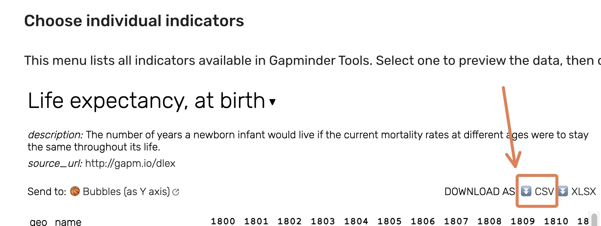
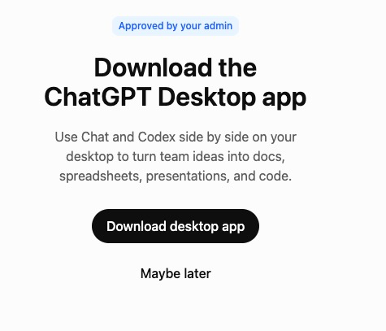
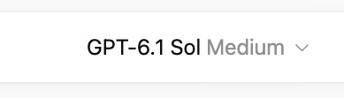
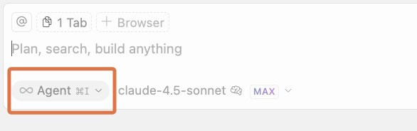
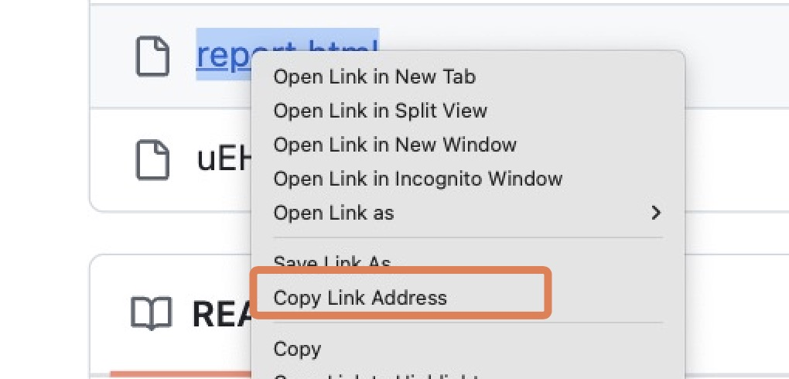
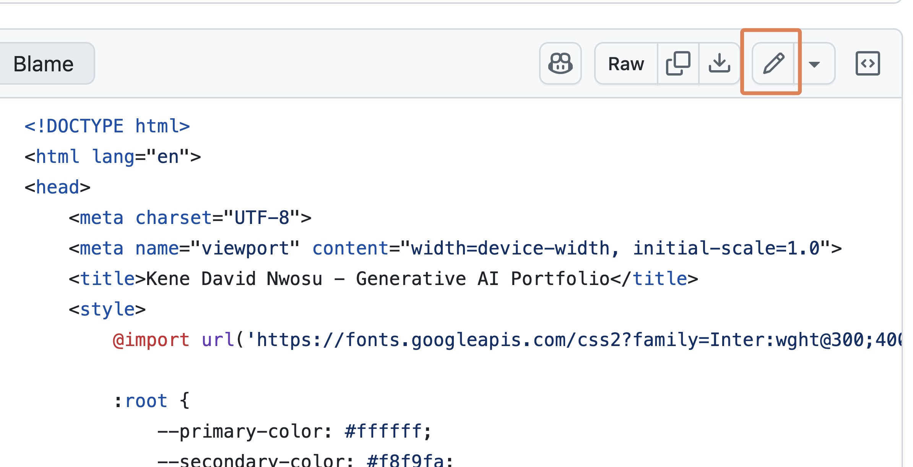
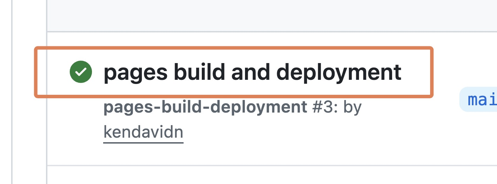

# Introduction

Welcome to another session of your Generative AI Workshop! In this session, you'll use Data Analysis AI tools to compile a brief report (HTML or PDF) analyzing the relationship between two chosen country indicators from the Gapminder data repository here: [https://gapminder.org/data](https://gapminder.org/data){target="_blank"}.

## Your final report should contain:

1.  A world map visualization of your first selected indicator (for the chosen recent year).
2.  A world map visualization of your second selected indicator (for the chosen recent year).
3.  A scatterplot showing the relationship between your two chosen indicators.
4.  A description and interpretation of the relationship between the two indicators. This may include a correlation coefficient (e.g., Pearson's $r$) if appropriate, or a qualitative description based on the scatterplot.
5.  A short section written by you (not the AI), with two parts:
    -   A quick summary of findings you noticed about the data.
    -   A short reflection about working with the AI. E.g. What was easy? What was difficult? What was surprising? What did you learn?

Note that rather than grading the technical precision of the report (we understand that you are not all data analysts), we will simply check that you have followed the overall instructions and written an honest reflection.

## Tool Tracks

You will choose one of the following tools based on your coding experience:

-   **Students WITHOUT significant coding experience:** You will use **ChatGPT**, a user-friendly AI chat tool, with its data analysis capabilities.

-   **Students WITH significant coding experience in R:** You should use **Cursor**, an AI-powered code editor, with R.

-   **If you finish your assigned tool track early, you are encouraged to try the other one!**

------------------------------------------------------------------------

# Part 1: General Setup & Data Selection (All Students)

1.  **Choose Your Data:**

    -   Go to Gapminder's data repository: [https://gapminder.org/data](https://gapminder.org/data){target="_blank"}
    -   Browse the indicators and **decide on TWO indicators** of interest that you think might be related. See below for two key notes on choosing your indicators.
    -   When you have decided on your two indicators, download the data as a CSV file for each indicator.

    {width="378"}

    -   **Key Notes on Choosing Your Indicators:**
        -   Make sure data is available for the year 2020, as we will be using this year for our analysis. (Official statistics often take a while to be released; 2020 is old enough that accurate data is likely to be available, and recent enough that the data is still relevant.)
        -   If you have no experience with data analysis, you may want to check with an instructor to make sure the indicators you choose actually make sense to analyze together. You can also fall back on the famous life expectancy vs. GDP per capita relationship.

------------------------------------------------------------------------

# Part 2: Tool-Specific Instructions

Please follow the instructions for the tool assigned to your group.

## Section A: For Students WITHOUT Prior Coding Experience (Using ChatGPT)

You will use ChatGPT, an AI chat-based tool, to analyze your data and generate content for your report.

::: {.callout-note}
**Side Note:** If you have paid Claude, paid Gemini, or paid Copilot, you can also try this there. The steps and screenshots below are written for ChatGPT, so you may have to transpose the instructions.
:::

1.  **Setup ChatGPT:**

    -   This workshop needs a **paid ChatGPT account**. Go to [chatgpt.com](https://chatgpt.com/){target="_blank"} and sign in (or create an account if you don't already have one).

    -   **If you don't have a paid account:** Give an instructor the email address you normally use for ChatGPT. We will grant you one month of access to The Graph Courses paid account. You will receive an invite in that email. Click the invite to join. Check your spam folder if you don't see it.

    -   **If you are asked to download the desktop app:** Click **Maybe later**.

    {width="380"}

    -   **If you are asked to connect your tools:** Click **Skip for now**.

    {width="400"}

    -   **If you are asked about memory:** Select **Use memory**. That is fine.

    {width="420"}

    -   **Use Work:** The toggle is at the top of the page. Select **Work**.

    {width="360"}

    -   **The default model is usually strong enough for this task.** The selector may show a name like **GPT-6.1 Sol Medium**. Leave that as it is.

    {width="320"}

2.  **Starting Your Analysis in ChatGPT:**

    -   Start a new chat in ChatGPT.

3.  **Chatting with ChatGPT:**

    -   First, upload your two CSV files to the conversation. This ensures ChatGPT has access to your data when you give it instructions. You can drag and drop them in, or you can click on the attachment (paperclip or "+") button near the chat input and select your two CSV files.

    -   Now we will write a prompt to ChatGPT to help us create a report on the relationship between two indicators. Replace `[FILL IN THOSE COUNTRIES]` with three countries from your data, then send the prompt to ChatGPT.

    ```
    I am writing a report on the relationship between two indicators

    Both datasets have been added.

    Run the following steps for the report:

    Create a world map for each indicator in 2020.

    Create a scatterplot showing the relationship between these two indicators in 2020.

    On the maps and the scatterplot, add labels and the actual amounts for these three countries: [XX, XX, XX]

    Provide both as PNG images to be downloaded.

    Do this in Python, and provide the Python script used, as a file to be downloaded.
    ```

-   **Review and Refine:** ChatGPT will show its steps, data, and plots. Work with it to refine the figures and text until you are happy with the output plots. For example, you can ask it to change the title of a plot, or to use a different color scheme.

-   If the AI seems to be going off track or taking too long, look for a "stop" button (often near the prompt input box) to interrupt it.

4.  **Creating Your Report Document:**
    -   **Download Outputs:** Download the individual plots (as images, e.g., PNG) and the Python script. You can also copy any key text outputs, such as data summaries or interpretations.
    -   **Create a DOCX/Google Docs file:** Open a word processor (like Microsoft Word, Google Docs, or Pages) and create a new document.
    -   **Assemble report:**
        -   Add a title, your name, and the date.
        -   Insert the plots you downloaded.
        -   Paste in the relevant text outputs from ChatGPT.
        -   Organize this content into a clean and readable report.
5.  **Add Your Reflection:**
    -   Before finalizing your report, add two things written by you (not the AI):
        -   A quick summary of findings you noticed about the data.
        -   A short reflection about working with the AI. E.g. What was easy? What was difficult? What was surprising? What did you learn?
6.  **Final Output:**
    -   **Export as PDF** from your word processor. This PDF is your primary submission.

## Section B: For Students WITH R Coding Experience (Using Cursor with R)

You will use Cursor to generate an R Markdown report. Cursor is an AI-powered code editor that can help you write code and create reports.

1.  **Setup Cursor:**

    -   You'll need to set up Cursor first, using the instructions.

    -   Note: Users in a few countries appear unable to access Cursor at the moment. You may need to use a VPN if this is the case. Or switch to the ChatGPT track.

    -   **Watch our setup video before you begin:** [AI Automated Data Analysis with R and Cursor (for R users only)](https://thegraphcourses.org/courses/aiw-2025-q2/topics/ai-automated-data-analysis-with-r-and-cursor-for-r-users-only/){target="_blank"}

2.  **Project folder:**

    -   Create a new project folder on your computer. Place the two CSV files you downloaded from Gapminder into this folder.

3.  **Generating Your Report in Cursor:**

    -   Open your project folder in Cursor. Create a new R Markdown (`.Rmd`) file with an appropriate name.

    -   Then use Cursor's "Agent Mode" to help you write the R code and narrative.

    {width="357"}

    -   **Initial Agent Prompt Idea:** Here is an example of an initial agent prompt:

        ``` update
        You are an AI agent that creates R data reports.
        You create reports by writing code to an Rmarkdown file (with github_document output), knitting that file, then reading the output md file to validate your work.
        You repeat this edit, knit, review loop until the reporting task is achieved.
        Use plots, tables, and inline R code where appropriate.
        Be sure to view a sample of each dataset to understand the data before you write code pertaining to it.
        Code should be hidden from the output.
        Your task will be further described below.
        ```

    -   **Specific Task Prompting Example:** Replace the bracketed parts with your indicator names and three countries from your data.

        ```         
        Now create a data report in my Rmd file using the two datasets I've provided:

        They are:
        - [TYPE YOUR INDICATOR 1 NAME HERE]
        - [TYPE YOUR INDICATOR 2 NAME HERE]

        The report should:
        1. For each indicator, subset the data to 2020.
        2. Create a world map visualization for each indicator in 2020.
        3. Create a scatterplot showing the relationship between these two indicators in 2020.
        4. On the maps and the scatterplot, add labels and the actual amounts for these three countries: [FILL IN THOSE COUNTRIES]
        5. Provide a brief interpretation of the relationship between the two indicators.
        ```

    -   **Troubleshooting R Package Installations:**

        -   If Cursor has persistent trouble installing R packages, you might need to install them manually. Create a temporary R script (`.R`) file in your project. In this script, use the `install.packages("package_name")` command for each required package. Run this script. R might ask you to choose a CRAN mirror (a server to download from); pick any. Once the packages are installed, you can delete the temporary R script.

    -   **Iterate and Refine:** Work with the agent to refine the figures and text until you are happy with the report. For example, you can ask it to change the title of a plot, or to use a different color scheme. If the AI seems to be going off track or taking too long, look for a "stop" button (often near the prompt input box) to interrupt it.

4.  **Add Your Reflection:** Before your final knit, add two things written by you (not the AI) directly into your R Markdown file. This should be part of the narrative of your report.
    -   A quick summary of findings you noticed about the data.
    -   A short reflection about working with the AI. E.g. What was easy? What was difficult? What was surprising? What did you learn?

5.  **Render the Final HTML:** When you are happy with the report, you can ask the AI agent to change the output format to a self-contained HTML file. Or you can do this yourself manually by using the YAML below in your .Rmd file. Then knit the file to render the HTML file.

    ```         
    output:
        html_document:
            self_contained: true
    ```

------------------------------------------------------------------------

# Verification

Do this after you have your maps, whether you used ChatGPT or Cursor.

1.  **Check the labeled countries against the data sheets.**

    -   On each map and on the scatterplot, find the three countries you asked the model to label.
    -   Compare each label and amount with the 2020 numbers in your CSV files.
    -   The plotted amounts should match the data sheets.

2.  **Cross-check with another agent, if you have time.**

    -   Try the same task in free [Gemini](https://gemini.google.com){target="_blank"}.
    -   Cross-checking between multiple agents is a great way to tell whether agents are generally capable, or whether they may be unreliable and making mistakes.

------------------------------------------------------------------------

# Part 3: Submission

-   Upload your final report file (HTML or PDF) to the designated submission link on the course workshop page.

------------------------------------------------------------------------

# Part 4: Optional - Add to Your GitHub Pages Portfolio

As a final step, you can add your report to your portfolio website which you created earlier in the course.

## Upload Your Report to GitHub

-   To get back to your repository home, visit github.com, click on your profile at the top right, then click on "Repositories"

    {width="324"}

-   Locate and click on your repository, which should be called something like `graph-ai-portfolio`

-   Locate the button or icon to "Add file". Click on it and select "Upload file"

    {width="459"}

-   Drag your final report file (HTML or PDF) into the box, then click on "Commit changes"

## Update Your Portfolio with ChatGPT or Gemini

-   Go to ChatGPT or Gemini and start typing a prompt like the one below. The parts in square brackets will need to be filled in with information you'll gather in the next steps.

    ```         
    I want to update my portfolio website. In your response, you will provide the FULL updated HTML code for the index.html file.

    The portfolio website is hosted at 

    [YOUR PORTFOLIO WEBSITE URL HERE].

    ---

    I want to add a new link for the project page for "Workshop 2: Automated Data Analysis".

    For this project, I analyzed Gapminder data to explore relationships between two global indicators using AI tools. 

    The report is available at the link below. (If the link is a PDF file, then we will embed the link directly. If it is an HTML file, we will reformat the link to be a clickable github pages link, as it is hosted on the same GitHub repo as the portfolio website.)

    [PASTE THE DIRECT LINK TO YOUR UPLOADED REPORT FILE HERE]

    ---

    Below is my current HTML file:

    [PASTE THE ENTIRE HTML FILE HERE]
    ```

-   Now, gather the information you need to complete the prompt:

## Get Your Portfolio Website URL

-   To get your portfolio website URL, go to your portfolio repository on GitHub. You can do this by clicking on the "Repositories" button at the top right of the page and then clicking on your portfolio repository.

-   Click on the "Settings" tab.

-   Scroll down to the "GitHub Pages" section.

-   Your portfolio website URL will be listed under "GitHub Pages". Copy and paste this into your prompt.

    {width="378"}

## Get the Direct Link to Your Report

-   Go back to your portfolio repository's main page and right‑click on the name of your uploaded report then → **Copy link address**. Paste this into your prompt.

    {width="378"}

## Copy Your Current index.html Code

-   Still in your portfolio repository, navigate to your index.html file.

    {width="374"}

-   Copy all the code from the index.html file with the copy code button at the top right. Paste this into your prompt.

    {width="372"}

## Send the Prompt and Update Your File

-   Now that you've filled in all the placeholders, send the prompt to ChatGPT or Gemini

-   Copy the new HTML that the LLM generated → return to your *index.html* on GitHub → click the **edit file** (✎) button at the top right.

    {width="452"}

-   Delete all the existing code in the file, then paste in the new code from ChatGPT or Gemini.

-   At the top right, click the **Commit changes** button.

-   Go to Actions tab (if you have GitHub Pages set up with Actions).

    {width="380"}

-   Click on the latest build to observe the build process.

    {width="353"}

-   After the build is complete, your live site, if refreshed, should now show the new project entry and the link should work!