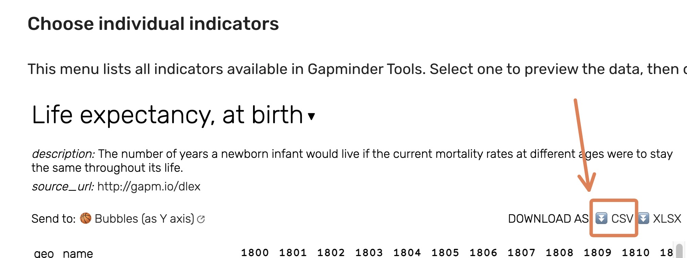

# Introduction

In this exercise, you'll use Data Analysis AI tools to compile a brief PDF report analyzing the relationship between two chosen country indicators from the Gapminder data repository here: [https://gapminder.org/data](https://gapminder.org/data){target="_blank"}.

## Your final report should contain:

1.  A world map visualization of your first selected indicator (for the chosen recent year).
2.  A world map visualization of your second selected indicator (for the chosen recent year).
3.  A scatterplot showing the relationship between your two chosen indicators.
4.  A description and interpretation of the relationship between the two indicators. This may include a correlation coefficient (e.g., Pearson's $r$) if appropriate, or a qualitative description based on the scatterplot.
5.  A short section written by you (not the AI), with two parts:
    -   A quick summary of findings you noticed about the data.
    -   A short reflection about working with the AI. E.g. What was easy? What was difficult? What was surprising? What did you learn?

Note that rather than grading the technical precision of the report (we understand that you are not all data analysts), we will simply check that you have followed the overall instructions and written an honest reflection.

## Tool

You will use **Gemini**, a free AI chat tool, to analyze your data and generate content for your report. Go to [gemini.google.com](https://gemini.google.com/){target="_blank"} and sign in with a Google account (or create one if you do not already have one).

Gemini is the tool we recommend for this exercise. If you already use another chat tool and prefer it, you can follow the same steps there.

------------------------------------------------------------------------

# Part 1: General Setup & Data Selection (All Students)

1.  **Choose Your Data:**

    -   Go to Gapminder's data repository: [https://gapminder.org/data](https://gapminder.org/data){target="_blank"}
    -   Browse the indicators and **decide on TWO indicators** of interest that you think might be related. See below for two key notes on choosing your indicators.
    -   When you have decided on your two indicators, download the data as a CSV file for each indicator.

    {width="378"}

    -   **Key Notes on Choosing Your Indicators:**
        -   Make sure data is available for the year 2020, as we will be using this year for our analysis. (Official statistics often take a while to be released; 2020 is old enough that accurate data is likely to be available, and recent enough that the data is still relevant.)
        -   If you have no experience with data analysis, you may want to check with an instructor to make sure the indicators you choose actually make sense to analyze together. You can also fall back on the famous life expectancy vs. GDP per capita relationship.

------------------------------------------------------------------------

# Part 2: Analyze the Data with Gemini

1.  **Start a new chat in Gemini.**

2.  **Upload your data and send a prompt:**

    -   First, upload your two CSV files to the conversation. This ensures Gemini has access to your data when you give it instructions. You can drag and drop them in, or you can click the attachment button near the chat input and select your two CSV files.

    -   Now write a prompt to create a report on the relationship between your two indicators. Replace `[XX, XX, XX]` with three countries from your data, then send the prompt.

    ```
    I am writing a report on the relationship between two indicators

    Both datasets have been added.

    Run the following steps for the report:

    Create a world map for each indicator in 2020.

    Create a scatterplot showing the relationship between these two indicators in 2020.

    On the maps and the scatterplot, add labels and the actual amounts for these three countries: [XX, XX, XX]

    Provide both as PNG images to be downloaded.

    Do this in Python, and provide the Python script used, as a file to be downloaded.
    ```

    -   **Review and Refine:** Gemini will show its steps, data, and plots. Work with it to refine the figures and text until you are happy with the output plots. For example, you can ask it to change the title of a plot, or to use a different color scheme.

    -   If the AI seems to be going off track or taking too long, look for a "stop" button (often near the prompt input box) to interrupt it.

3.  **Creating Your Report Document:**
    -   **Download Outputs:** Download the individual plots (as images, e.g., PNG) and the Python script. You can also copy any key text outputs, such as data summaries or interpretations.
    -   **Create a DOCX/Google Docs file:** Open a word processor (like Microsoft Word, Google Docs, or Pages) and create a new document.
    -   **Assemble report:**
        -   Add a title, your name, and the date.
        -   Insert the plots you downloaded.
        -   Paste in the relevant text outputs from Gemini.
        -   Organize this content into a clean and readable report.
4.  **Add Your Reflection:**
    -   Before finalizing your report, add two things written by you (not the AI):
        -   A quick summary of findings you noticed about the data.
        -   A short reflection about working with the AI. E.g. What was easy? What was difficult? What was surprising? What did you learn?
5.  **Final Output:**
    -   **Export as PDF** from your word processor. This PDF is your primary submission.

------------------------------------------------------------------------

# Verification

Do this after you have your maps.

1.  **Check the labeled countries against the data sheets.**

    -   On each map and on the scatterplot, find the three countries you asked the model to label.
    -   Compare each label and amount with the 2020 numbers in your CSV files.
    -   The plotted amounts should match the data sheets.

2.  **Cross-check with another chat tool, if you have time.**

    -   If you already use another AI chat tool, try the same task there.
    -   Cross-checking between tools is a great way to tell whether they are generally capable, or whether they may be unreliable and making mistakes.

------------------------------------------------------------------------

# Part 3: Submission

Email your final PDF report to [courses@thegraphnetwork.org](mailto:courses@thegraphnetwork.org).

Use this subject line, replacing the name with your own:

`Quantitative Methods Submission 1: FIRST NAME LAST NAME`