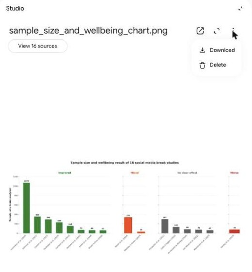
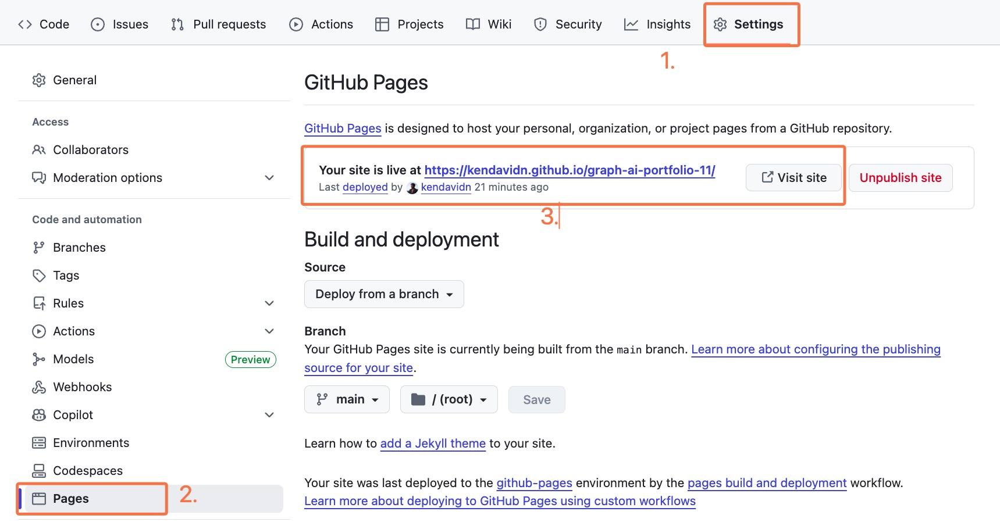
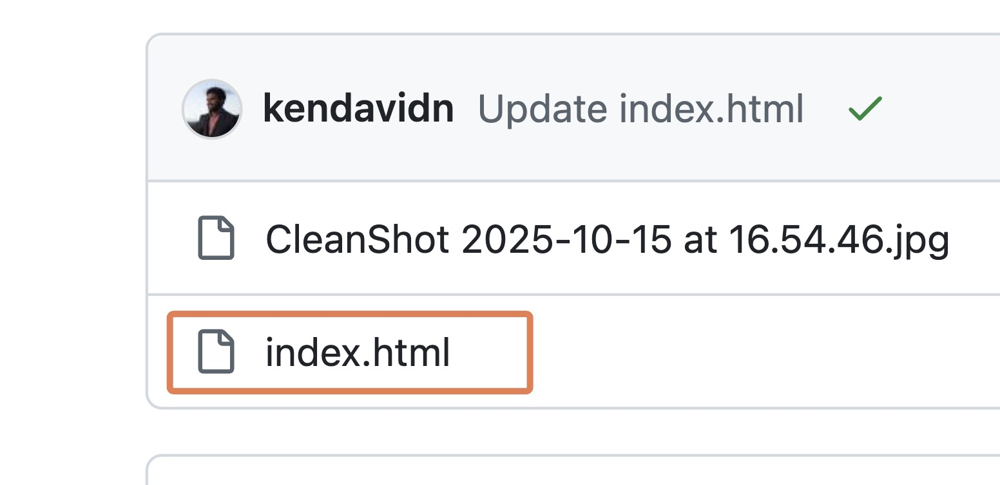
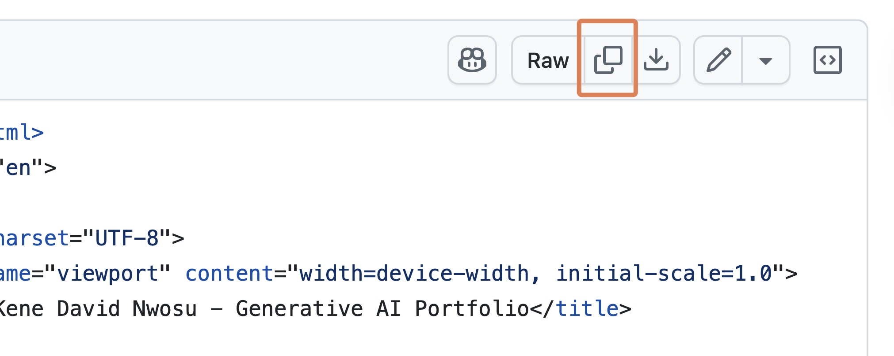
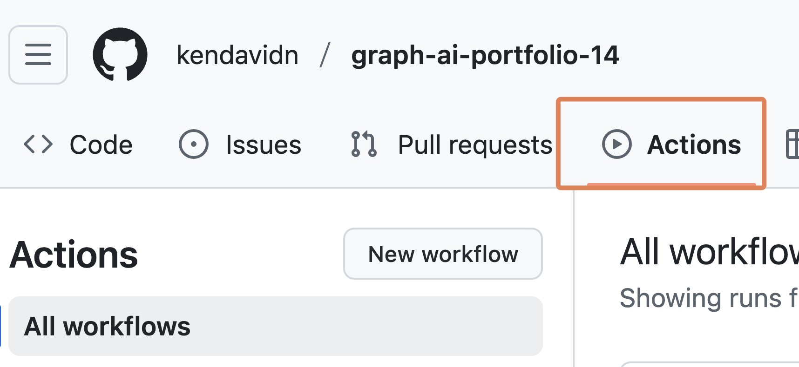

# Introduction

In this workshop you will use **Gemini Notebook** to do a short literature review on the question: **does quitting or cutting down on social media improve people's mood?**

Prior to the workshop, we compiled a collection of 14 open-access papers on this question, roughly mirroring the set used in a recent meta-analysis by Lemahieu et al. (2025), plus some more recent papers and some studies that the meta-analysis excluded.

Our goal is to get a broad up-to-date understanding of the evidence of this question, using a table of key information from each paper plus a figure summarising the pattern of results.

------------------------------------------------------------------------

# Part 0: Download the Papers

Download and unzip the collection: [lit_review_social_media_break.zip](https://github.com/the-graph-courses/aiw_2026_t3_materials/raw/main/week_03_workshop/data/lit_review_social_media_break.zip){target="_blank"}. (On Windows: right-click → "Extract All". On Mac: double-click the zip.)

All 14 papers are experiments in which adults were asked to **quit** social media, or to **cut down** on it, for between 1 and 28 days, and their mood and/or life satisfaction was compared with a control group. Some papers report more than one comparison (for example, Przybylski 2021 ran three separate experiments, and Hartanto 2025 had both a quit group and a cut-down group), so your table will have more rows than papers.


------------------------------------------------------------------------

# Part 1: Create a Notebook and Add the Papers

1.  Go to [notebook.google.com](https://notebook.google.com){target="_blank"} and sign in with your Google account.
2.  Click **+ New notebook** (on the home page) or **+ Create notebook** (top right, from inside a notebook). You get an empty notebook with three panels: **Sources** (left), the chat (middle) and **Studio** (right).

3.  Drag all 14 files onto the "Drag & drop your files" box at the left hand side of the screen.

4.  Rename the notebook by clicking "Untitled notebook" at the top left.

------------------------------------------------------------------------

# Part 2: Ask for an Extraction Table

Click in the box at the bottom that says **"Ask a question or create something"**, paste the prompt below, and press Enter.

```
Make a table of these 14 papers.
If a paper has several experiments, or both a quit group and a social media reduction group, give each its own row.
Cite the source passage for each cell.
If a detail is not reported, write "Not stated".

Columns:
1. Study: first author(s) and year. If a paper has more than one row, name the group (e.g. "Przybylski et al. (2021), Experiment 2").
2. Design: one of RCT, Non-randomised experiment, Within-person.
3. Sample description (e.g. "78; university students, UAE").
4. Intervention: Quit or Limit; platforms; length in days (e.g. "Limit; all social media, 30 min/day; 14").
5. Positive affect result: effect on positive mood versus the control. One of: Improved, No clear effect, Worse, Not measured.
```

After a minute or two you should get an output table. Each small number in a cell is a **citation**: hover over or click it to see the passage in the PDF it came from. 

Check at least 5 values and claims against the original papers to ensure they are correct. If you find any errors, ask the notebook to correct them.

Also check that all 14 papers appear in the table, and that every cell in **Positive affect result** is one of the four allowed answers. 

------------------------------------------------------------------------

# Part 3: Make a Figure

A quick figure helps you see the overall pattern before you write. In the same chat, try to create a visualisation that you think would be helpful to understand the pattern of results. One option is given below:

```
Make a bar chart from the table above with sample size on the y-axis. Color and group the bars by the Positive affect result (Improved, No clear effect, Worse, Not measured).
```

The chart should appear as a file in the **Studio** panel on the right. Click it to open it. Check it against your table (every row there, in the right panel, with the right number), and ask for changes if needed ("Make the labels bigger", "Label each bar with the study name").

To download it, open the chart in Studio and click **⋮** (top right) → **Download**.

{width="400"}

# Part 4: Start Your Google Doc

We would now like to summarise the evidence in a Google Doc. Go to [docs.new](https://docs.new){target="_blank"} and create a new Google Doc. Give it a title and add these headings (Format → Paragraph styles → Heading 2):

```
1. Summary of the evidence
2. Comparison with the meta-analysis
3. Use of AI
4. Figure
5. Appendix: Extraction table
```

## Summary of the evidence

Write 1-2 paragraphs yourself. Use your table, your figure, and the meta-analysis. Do not ask the AI to write them, and do not mention every study.

> We reviewed [xx] experiments in which people were asked to quit or cut down on social media. Some report.... others find little change.... while a few find a cost, such as ([Author, year]). 

## Comparison with the meta-analysis

Your 14 papers are a hand-picked set. [Lemahieu et al. (2025)](https://doi.org/10.1038/s41598-025-90984-3){target="_blank"} is a systematic review and meta-analysis of complete breaks. Briefly review the paper abstract and figure 3 to understand the main findings.

Write 2-3 sentences on what that estimate shows that your table does not.

## Use of AI

An expectation when using AI tools within academic work is that you name the specific tool you used, what it did, and how you checked the results. You can use a template like this:

> I used Gemini Notebook (Google; accessed [date]) to extract details from 14 studies. I checked [X] of them against the articles and corrected [n]. I wrote the text myself. 

## Figure and extraction table

Next, you need to paste the extraction table under **Appendix: Extraction table**. You can drag to highlight the table and copy it to the clipboard, then paste it into the Google Doc.

Under **Figure**, download the PNG you created and insert it.

# Part 5: Submission

To submit, download the doc as a PDF (**File → Download → PDF document**) and upload it to the submission form on the website. 

# Part 6: Optional Challenge: Your Own PDFs *(ungraded)*

Repeat Parts 1 to 4 on at least 10 PDFs you are allowed to upload. Design 4-7 short columns, as in Part 2, including one with a fixed set of answers you can chart, and add a figure and an AI-use statement. Skip the meta-analysis comparison and the summary template above. This is not part of the submission.

# Part 7: Optional: Add to Your GitHub Pages Portfolio

As a final step, you can add your PDF to the portfolio website you created earlier in the course.

## Upload Your PDF to GitHub

-   To get back to your repository home, visit github.com, click on your profile at the top right, then click on "Repositories"

    {width="324"}

-   Locate and click on your repository, which should be called something like `graph-ai-portfolio`

-   Locate the button or icon to "Add file". Click on it and select "Upload file"

    {width="459"}

-   Drag the PDF you downloaded in Part 5 into the box, then click on "Commit changes"

## Update Your Portfolio with ChatGPT or Gemini

-   Go to ChatGPT or Gemini and start typing a prompt like the one below. The parts in square brackets will need to be filled in with information you'll gather in the next steps.

    ```         
    I want to update my portfolio website. In your response, you will provide the FULL updated HTML code for the index.html file.

    The portfolio website is hosted at 

    [YOUR PORTFOLIO WEBSITE URL HERE].

    ---

    I want to add a new link for the project page for "Workshop 3: AI-Assisted Literature Review".

    For this project, I used Gemini Notebook to extract key details from 14 experiments on whether quitting or cutting down on social media improves mood, checked the AI's extraction against the original papers, made a figure of the results, and wrote a short summary of the evidence that I compared with a published meta-analysis.

    The report is a PDF file, available at the link below. Embed the link directly.

    [PASTE THE DIRECT LINK TO YOUR UPLOADED PDF HERE]

    ---

    Below is my current HTML file:

    [PASTE THE ENTIRE HTML FILE HERE]
    ```

-   Now, gather the information you need to complete the prompt:

## Get Your Portfolio Website URL

-   To get your portfolio website URL, go to your portfolio repository on GitHub. You can do this by clicking on the "Repositories" button at the top right of the page and then clicking on your portfolio repository.

-   Click on the "Settings" tab.

-   Scroll down to the "GitHub Pages" section.

-   Your portfolio website URL will be listed under "GitHub Pages". Copy and paste this into your prompt.

    {width="378"}

## Get the Direct Link to Your PDF

-   Go back to your portfolio repository's main page and right‑click on the name of your uploaded PDF then → **Copy link address**. Paste this into your prompt.

    {width="378"}

## Copy Your Current index.html Code

-   Still in your portfolio repository, navigate to your index.html file.

    {width="374"}

-   Copy all the code from the index.html file with the copy code button at the top right. Paste this into your prompt.

    {width="372"}

## Send the Prompt and Update Your File

-   Now that you've filled in all the placeholders, send the prompt to ChatGPT or Gemini

-   Copy the new HTML that the LLM generated → return to your *index.html* on GitHub → click the **edit file** (✎) button at the top right.

    {width="452"}

-   Delete all the existing code in the file, then paste in the new code from ChatGPT or Gemini.

-   At the top right, click the **Commit changes** button.

-   Go to Actions tab (if you have GitHub Pages set up with Actions).

    {width="380"}

-   Click on the latest build to observe the build process.

    {width="353"}

-   After the build is complete, your live site, if refreshed, should now show the new project entry and the link should work!
