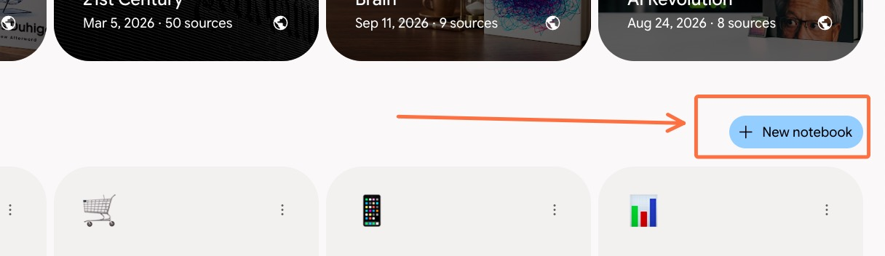
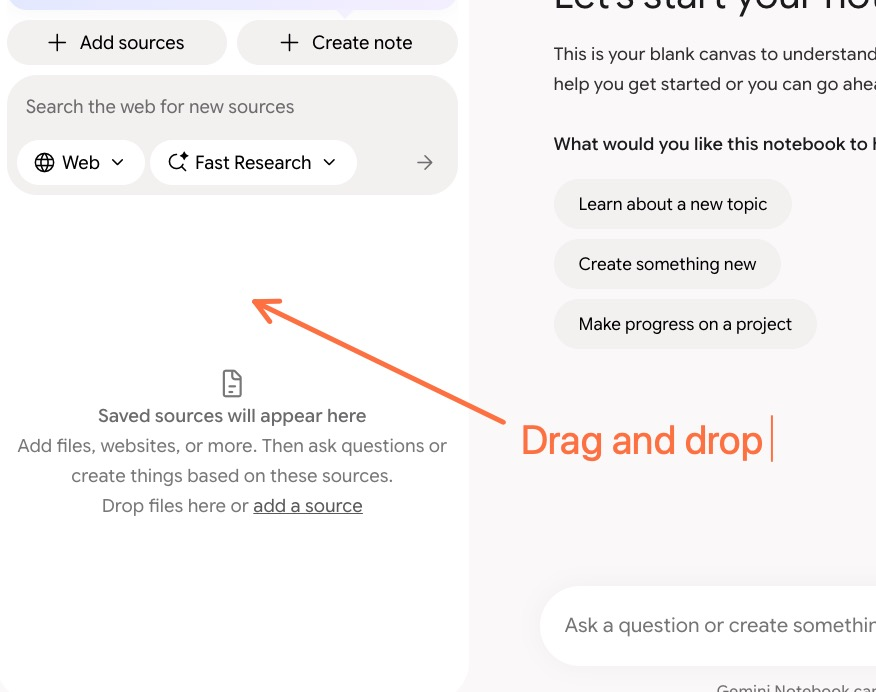
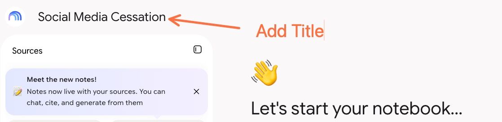
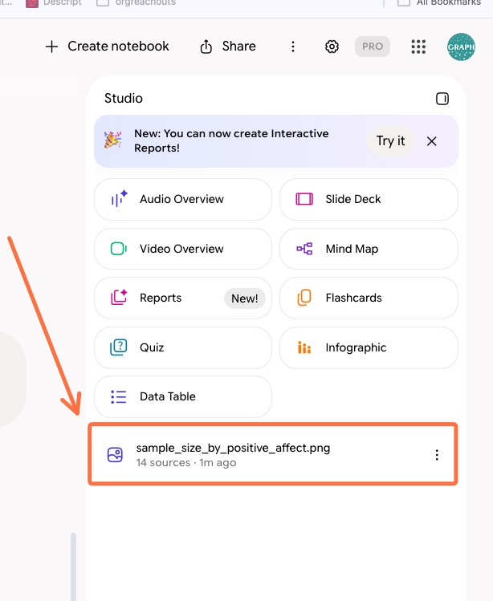
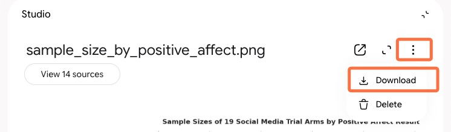

# Introduction

In this workshop you will use **Gemini Notebook** to do a short literature review on the question: **does quitting or cutting down on social media improve people's mood?**

Prior to the workshop, we used ChatGPT and Claude to search for and compile a collection of 14 open-access papers on this question. Our selection roughly mirrors the set used in a recent meta-analysis by Lemahieu et al. (2025), but we also include some studies that fell outside its scope (their analysis was limited to complete breaks from social media, so it left out studies where people only cut down), plus a few that it missed and some more recent papers.

Our goal is to get a broad up-to-date overview of the evidence on this question, using a table of key information from each paper, and then to summarise it in two paragraphs of a paper introduction.

------------------------------------------------------------------------

# Part 1: Download the Papers

Download and unzip the collection: [lit_review_social_media_break.zip](https://github.com/the-graph-courses/aiw_2026_t3_materials/raw/main/week_03_workshop/data/lit_review_social_media_break.zip){target="_blank"}. (On Windows: right-click → "Extract All". On Mac: double-click the zip.)

All 14 papers are experiments in which adults were asked to **quit** social media, or to **cut down** on it, for between 1 and 28 days, and their mood and/or life satisfaction was compared with a control group. 

Some papers report more than one comparison (for example, Przybylski 2021 ran three separate experiments, and Hartanto 2025 had both a quit group and a cut-down group), so your data extraction table may have more rows than papers.

Next we will use Gemini Notebook to create a data extraction table.

::: callout-note
## Why Gemini Notebook instead of a general chatbot?

The primary benefit of Gemini Notebook is that every claim comes with a numbered citation you can click to see the exact passage in the source. 

This makes it easy to have a human cross-check each claim against the original paper.
:::

------------------------------------------------------------------------

# Part 2: Create a Notebook and Add the Papers

1.  Go to [notebook.google.com](https://notebook.google.com){target="_blank"} and sign in with your Google account.
2.  Click **+ New notebook** (on the home page) or **+ Create notebook** (top right, from inside a notebook). You get an empty notebook with three panels: **Sources** (left), the chat (middle) and **Studio** (right).

    {width="450"}

3.  Drag all 14 files onto the "Drag & drop your files" box at the left hand side of the screen.

    {width="400"}

4.  Rename the notebook by clicking "Untitled notebook" at the top left.

    {width="400"}

------------------------------------------------------------------------

# Part 3: Ask for an Extraction Table

Click in the box at the bottom that says **"Ask a question or create something"**, paste the prompt below, and press Enter.

```
Make a table of these 14 papers.
If a paper has several experiments or comparisons, give each its own row.
Cite the source passage for the claim in each cell.
If a detail is not reported, write "Not stated".

Columns:
1. Study: first author(s) and year.
2. Design: one of RCT, Non-randomised experiment, Within-person.
3. Sample description (e.g. "78; university students, UAE").
4. Short intervention description. 
5. Positive affect result: effect on positive mood versus the control. One of: Improved, No clear effect, Worse, Not measured.
```

After a minute or two you should get an output table. Each small number in a cell is a **citation**: hover over or click it to see the passage in the source it came from. You'll check the rows you rely on in Part 5.

------------------------------------------------------------------------

# Part 4: Make a Figure

A quick figure can help you see the overall pattern before you write. 

In the same chat, ask the AI to create a visualisation that you think would be helpful to understand the pattern of results. One option is given below:

```
Make a bar chart from the table above with sample size on the x-axis. 
Color and group the bars by the Positive affect result (Improved, No clear effect, Worse, Not measured).
```

The chart should appear as a file in the **Studio** panel on the right. Click it to open it. Check it against your table (every row there, in the right panel, with the right number), and ask for changes if needed ("Make the labels bigger", "Label each bar with the study name").

{width="350"}

To download it, open the chart in Studio and click **⋮** (top right) → **Download**.

{width="450"}

------------------------------------------------------------------------

# Part 5: Write It Up

We would now like to summarise the evidence in a Google Doc. Go to [docs.new](https://docs.new){target="_blank"} and create a new Google Doc. Give it a title and add these headings:

```
1. Draft Introduction: Prior Evidence
2. References
3. Use of AI
```

## Draft Introduction: Prior Evidence

Imagine you're writing part of the introduction to a research paper on whether taking a break from social media improves mood in **adolescents**. All 14 of your papers studied adults, so your job is to summarise what this adult evidence shows, then mention that it doesn't answer the question for teenagers.

You don't need to cite all 14 papers. You might only need to cite one or two good examples for each point you make. Choose the largest or most relevant studies, or one quit study and one cut-down study. Use "e.g." when you're only giving examples.

**Check every paper you cite.** Before you cite a study, open the original PDF and check each cell in the corresponding row in the table (design, sample, intervention, result), cross-checking against the original paper source.

You can start from the template below: fill in each `[bracket]` from your table, then edit it into your own words.

> Several experiments in adults have tested whether quitting or cutting down on social media improves mood, with mixed results. Some found improvements in positive mood (e.g. [Author, year]), others found no clear effect (e.g. [Author, year]), and [a few / one] found that mood got worse (e.g. [Author, year]). However, these studies recruited mainly [xxxxxx], and none included participants under 18.  It therefore remains unclear whether [xxxxx].

## References

Back in Gemini Notebook, ask for the references of only the papers you cited:

```
Give APA 7 references for: [Author, year; Author, year; ...]
```

Check each one against the paper's first page, then paste the list under the heading **References** in your Google Doc.

## Use of AI

An expectation when using AI tools within academic work is that you name the specific tool you used, what it did, and how you checked the results. You can use a template like this:

> I used Gemini Notebook (Google; accessed [date]) as part of my literature review to extract details from 14 studies. I checked all cited claims against the original papers.

------------------------------------------------------------------------

# Part 6: Submission

To submit, download the doc as a PDF (**File → Download → PDF document**) and upload it to the submission form on the website. 

# Part 7 (Optional): Add to Your GitHub Pages Portfolio

As a final step, you can add your PDF to the portfolio website you created earlier in the course.

## Upload Your PDF to GitHub

-   To get back to your repository home, visit github.com, click on your profile at the top right, then click on "Repositories"

    {width="324"}

-   Locate and click on your repository, which should be called something like `graph-ai-portfolio`

-   Locate the button or icon to "Add file". Click on it and select "Upload file"

    {width="459"}

-   Drag the PDF you downloaded in Part 6 into the box, then click on "Commit changes"

## Update Your Portfolio with ChatGPT or Gemini

-   Go to ChatGPT or Gemini and start typing a prompt like the one below. The parts in square brackets will need to be filled in with information you'll gather in the next steps.

    ```         
    I want to update my portfolio website. In your response, you will provide the FULL updated HTML code for the index.html file.

    The portfolio website is hosted at 

    [YOUR PORTFOLIO WEBSITE URL HERE].

    ---

    I want to add a new link for the project page for "Workshop 3: AI-Assisted Literature Review".

    For this project, I used Gemini Notebook to extract key details from 14 experiments on whether quitting or cutting down on social media improves mood, checked the AI's extraction against the original papers, and drafted two paragraphs of a paper introduction that summarise the adult evidence and set out the gap for adolescents.

    The report is a PDF file, available at the link below. Embed the link directly.

    [PASTE THE DIRECT LINK TO YOUR UPLOADED PDF HERE]

    ---

    Below is my current HTML file:

    [PASTE THE ENTIRE HTML FILE HERE]
    ```

-   Now, gather the information you need to complete the prompt:

## Get Your Portfolio Website URL

-   To get your portfolio website URL, go to your portfolio repository on GitHub. You can do this by clicking on the "Repositories" button at the top right of the page and then clicking on your portfolio repository.

-   Click on the "Settings" tab.

-   Scroll down to the "GitHub Pages" section.

-   Your portfolio website URL will be listed under "GitHub Pages". Copy and paste this into your prompt.

    {width="378"}

## Get the Direct Link to Your PDF

-   Go back to your portfolio repository's main page and right‑click on the name of your uploaded PDF then → **Copy link address**. Paste this into your prompt.

    {width="378"}

## Copy Your Current index.html Code

-   Still in your portfolio repository, navigate to your index.html file.

    {width="374"}

-   Copy all the code from the index.html file with the copy code button at the top right. Paste this into your prompt.

    {width="372"}

## Send the Prompt and Update Your File

-   Now that you've filled in all the placeholders, send the prompt to ChatGPT or Gemini

-   Copy the new HTML that the LLM generated → return to your *index.html* on GitHub → click the **edit file** (✎) button at the top right.

    {width="452"}

-   Delete all the existing code in the file, then paste in the new code from ChatGPT or Gemini.

-   At the top right, click the **Commit changes** button.

-   Go to Actions tab (if you have GitHub Pages set up with Actions).

    {width="380"}

-   Click on the latest build to observe the build process.

    {width="353"}

-   After the build is complete, your live site, if refreshed, should now show the new project entry and the link should work!
