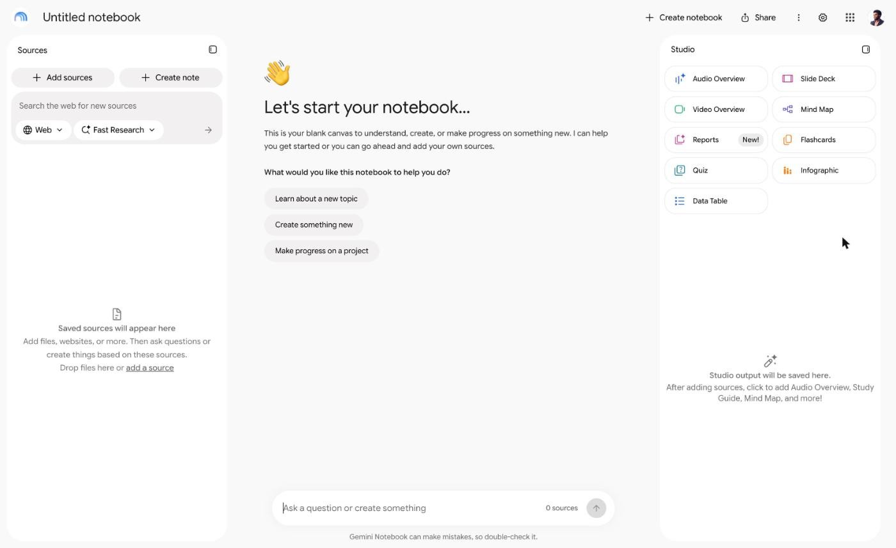
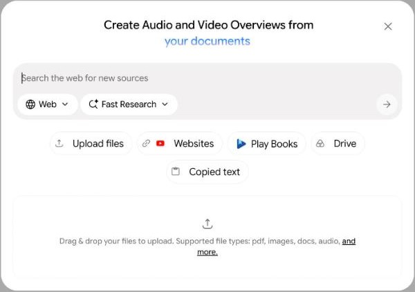

<!-- DRAFT v5. Fuses v4 (Gemini Notebook walkthrough, tested 18 Oct 2026 with an earlier set of 16 PDFs)
with the v2 corpus work. Literature option only; the qualitative option was dropped. Bringing your own PDFs is an optional challenge under Submission, not an alternate path.
Corpus: 14 free-to-read papers, 17 comparison rows, chosen to be comparable with Lemahieu et al. 2025 (Sci Rep), which
pooled 10 studies of complete social media abstinence (positive affect g = 0.03, n.s.). 6 papers are in the review;
4 are complete-break studies not in it (Asimovic 2021, Arceneaux 2024, Walsh 2024, Hartanto 2025); 4 are cut-down
studies the review excluded by design (Collis 2022, Faulhaber 2023, Maerevoet 2025, van Wezel 2021). Not included:
the review's 4 paywalled studies; studies with no control group or other outcomes (kept in the admin repo: aiw_2026_t3_admin/week_03_workshop_v2/data/_set_aside_lit_review/).
TODO before release:
  - Push data/lit_review_social_media_break.zip and data/reference/ to aiw_2026_t3_materials.
  - Re-run Parts 2-3 in a fresh notebook with these 14 papers: check the table has 17 rows, re-test the figure prompt,
    and replace images/gn_chart_example.png and the example paragraph (both from the earlier 16-paper set).
  - Free plan limits seen in reviews (Aug 2026): 50 sources per notebook, 50 chats per day. Fine for 14 PDFs. -->

# Introduction

In this workshop you will use **Gemini Notebook** to do a short literature review on the question: **does quitting or cutting down on social media improve people's mood?**.

Prior to the workshop, we compiled a collection of 14 open-access papers on this question, roughly mirroring the set used in a recent meta-analysis by Lemahieu et al. (2025), but some more recent papers and some studies that were excluded from the meta-analysis.

Our goal is to get a broad up-to-date understanding of the evidence of this question, using a table of key information from each paper plus a figure summarising the pattern of results.


::: callout-note
## Why Gemini Notebook instead of a general chatbot?

The primary benefit of Gemini Notebook is that every claim comes with a numbered citation you can click to see the exact passage in the PDF. And it's possible to include these within tables of key information. This makes it easier to cross-check it's accuracy. 

Other tools that have this feature include Scispace and Elicit, which you may want to try in your own time.
:::

## Prerequisites

-   A Google account (for Gemini Notebook and Google Docs).

------------------------------------------------------------------------

# Part 0: Download the Papers

Download and unzip the collection: [lit_review_social_media_break.zip](https://github.com/the-graph-courses/aiw_2026_t3_materials/raw/main/week_03_workshop/data/lit_review_social_media_break.zip){target="_blank"}. (On Windows: right-click → "Extract All". On Mac: double-click the zip.)

All 14 papers are experiments in which adults were asked to **quit** social media, or to **cut down** on it, for between 1 and 28 days, and their mood and/or life satisfaction was compared with a control group. Some papers report more than one comparison (Przybylski 2021 ran three separate experiments; Hartanto 2025 had both a quit group and a cut-down group), so if done correctly, your table will have **17 rows**.

::: callout-tip
These papers are all free to read, which is why we can use them. **Do not upload confidential documents** (unpublished manuscripts, your organisation's internal reports, identifiable data) to AI tools unless you have permission to do so. This applies especially if you bring your own PDFs.
:::

------------------------------------------------------------------------

# Part 1: Create a Notebook and Add the Papers

1.  Go to [notebook.google.com](https://notebook.google.com){target="_blank"} and sign in with your Google account.
2.  Click **+ New notebook** (on the home page) or **+ Create notebook** (top right, from inside a notebook). You get an empty notebook with three panels: **Sources** (left), the chat (middle) and **Studio** (right).

    {width="650"}

3.  Click **+ Add sources**, then **Upload files**, and select all 14 PDFs at once. (Or drag all 14 files onto the "Drag & drop your files" box.)

    {width="450"}

4.  Wait until all 14 files appear in the Sources panel, each with a tick. Rename the notebook by clicking "Untitled notebook" at the top left.

------------------------------------------------------------------------

# Part 2: Ask for an Extraction Table

Click in the box at the bottom that says **"Ask a question or create something"**, paste the prompt below, and press Enter.

::: callout-tip
Paste with **Ctrl+Shift+V** (Windows) or **Cmd+Shift+V** (Mac) to paste as plain text. Formatted text can turn into giant headings in the chat.
:::

```
Make a table of these 14 papers.
If a paper has several experiments, or both a quit group and a social media reduction group, give each its own row.
Cite the source passage for each cell.
If a detail is not reported, write "Not stated".

Columns:
1. Study: first author(s) and year. If a paper has more than one row, name the group (e.g. "Przybylski et al. (2021), Experiment 2").
2. Design: one of RCT, Non-randomised experiment, Within-person.
3. Sample description (e.g. "78; university students, UAE").
4. Intervention: Quit or Limit; platforms; length in days (e.g. "Limit; all social media, 30 min/day; 14").
5. Positive affect result: effect on positive mood versus the control. One of: Improved, No clear effect, Worse, Not measured.
```

After a minute or two you should get an output table. Each small number in a cell is a **citation**: hover over or click it to see the passage in the PDF it came from. 

Check at least 5 values and claims against the original papers to ensure they are correct. If you find any errors, ask the notebook to correct them.

Also check that there are **17 rows** covering all 14 papers, and every cell in **Positive affect result** is one of the four allowed answers. 


------------------------------------------------------------------------

# Part 3: Make a Figure

A quick figure helps you see the overall pattern before you write. In the same chat, try to create a visualisation that you think would be helpful to understand the pattern of results. One option is given below:

```
Make a bar chart from the table above with sample size on the y-axis. Color and group the bars by the Positive affect result (Improved, No clear effect, Worse).
```

The chart should appear a file in the **Studio** panel on the right. Click it to open it. Check it against your table (every row there, in the right panel, with the right number), and ask for changes if needed ("Make the labels bigger", "Use blue for Quit and orange for Limit").

To download it, open the chart in Studio and click **⋮** (top right) → **Download**.

{width="400"}

# Part 4: Start Your Google Doc

We would now like to summarise the evidence in a Google Doc. Go to [docs.new](https://docs.new){target="_blank"} and create a new Google Doc. Give it a title and add these headings (Format → Paragraph styles → Heading 2):

```
1. Summary of the evidence
2. Comparison with the meta-analysis
3. Use of AI
4. Figure
5. Appendix: Extraction table
```

------------------------------------------------------------------------

# Part 5: Submission

Submit the Google Doc from Part 4, as a link (**Share → Anyone with the link → Commenter**) or a PDF (**File → Download → PDF**).

We are not grading the science. We will check that the five sections are there, that your summary matches your table, and that your AI-use statement matches what you did.

## Comparison with the meta-analysis

Your 14 papers are a hand-picked set. [Lemahieu et al. (2025)](https://doi.org/10.1038/s41598-025-90984-3){target="_blank"} is a systematic review and meta-analysis of complete breaks, and it includes 6 of them. Open the paper and look at **Figure 3** (each square is one study; the diamond is the combined estimate).

Write 2-3 sentences on what that estimate shows that your table does not.

## Summary of the evidence

Write 1-2 paragraphs yourself. Use your table, your figure, and the meta-analysis. Do not ask the AI to write them, and do not mention every study.

> Several experiments have asked people to quit or cut down on social media. Some report [a benefit] ([Author, year]; [Author, year]). Others find little change ([Author, year]), and a few find a cost, such as [lower life satisfaction] ([Author, year]). A meta-analysis of complete breaks found [the pooled result, in plain words] (Lemahieu et al., 2025). Most breaks lasted about a week and most participants were [who took part], so it is unclear whether [the limit of these findings].

## Use of AI

Name the tool, what it did, and what you checked. You remain responsible for the text.

> I used Gemini Notebook (Google; accessed [date]) to extract details from 14 studies. I checked [X] of them against the articles and corrected [n]. I wrote the text myself. I take full responsibility for the content.

## Figure and extraction table

Paste the extraction table under **Appendix: Extraction table** (use the copy icon under the chat reply, then delete any leftover chat text). Under **Figure**, insert the PNG you downloaded.

## Optional: add it to your portfolio

Download the doc as a PDF, add it to your portfolio repository, and ask an AI tool to link it from `index.html` as an AI-assisted summary of these 14 experiments, including your check of the extraction, the meta-analysis comparison, and your AI-use statement.

## Optional challenge: your own PDFs *(ungraded)*

Repeat Parts 1 to 4 on at least 10 PDFs you are allowed to upload (see the warning in Part 0). Design 4-7 short columns, as in Part 2, including one with a fixed set of answers you can chart, and add a figure and an AI-use statement. Skip the meta-analysis comparison and the summary template above. This is not part of the submission.

------------------------------------------------------------------------

# Data Sources and Licences

Each paper remains under its publisher's licence. The PDFs in the zip are free-to-read versions (publisher open access, NBER working paper, or a copy posted by the authors or their institution). Meta-analysis: Lemahieu, L., Vander Zwalmen, Y., Mennes, M., Koster, E. H. W., Vanden Abeele, M. M. P. & Poels, K. (2025), *The effects of social media abstinence on affective well-being and life satisfaction: a systematic review and meta-analysis*, Scientific Reports 15: 7581, [doi:10.1038/s41598-025-90984-3](https://doi.org/10.1038/s41598-025-90984-3){target="_blank"}, CC BY 4.0.
