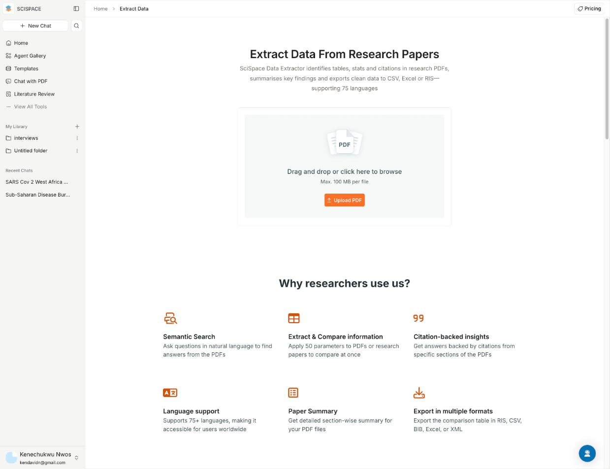
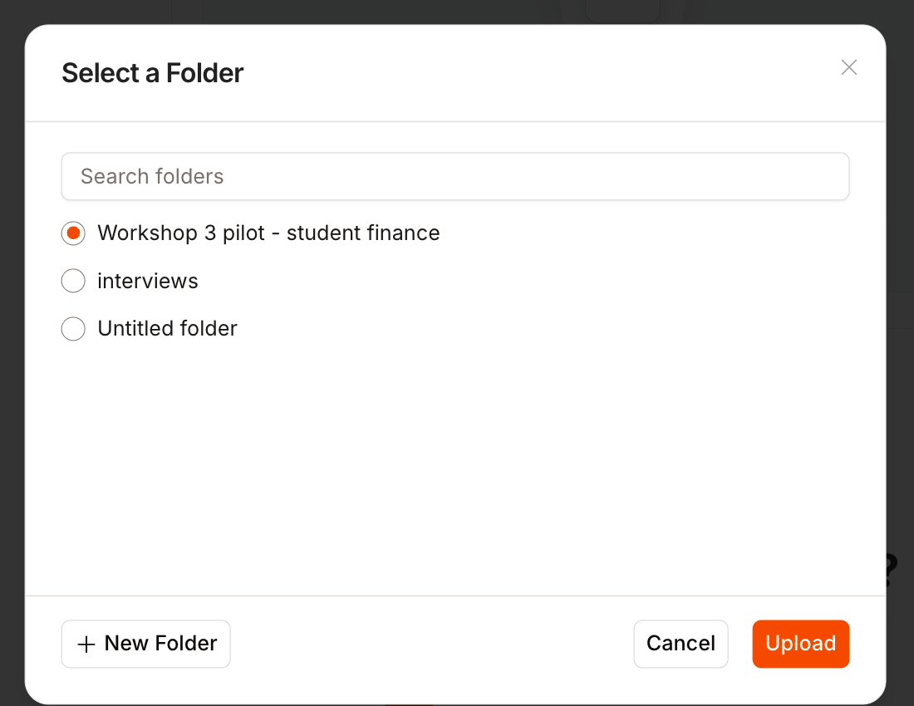
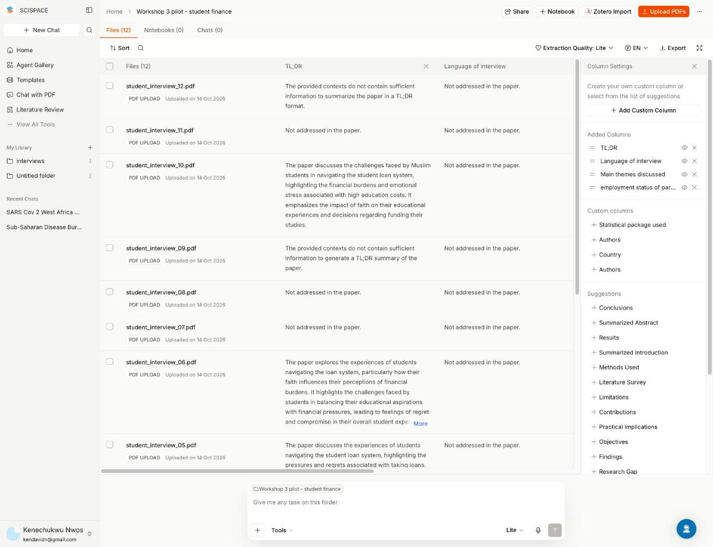
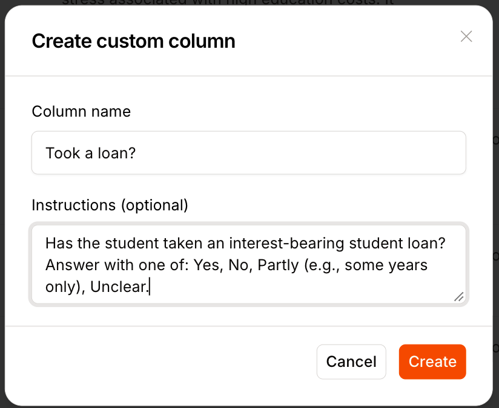
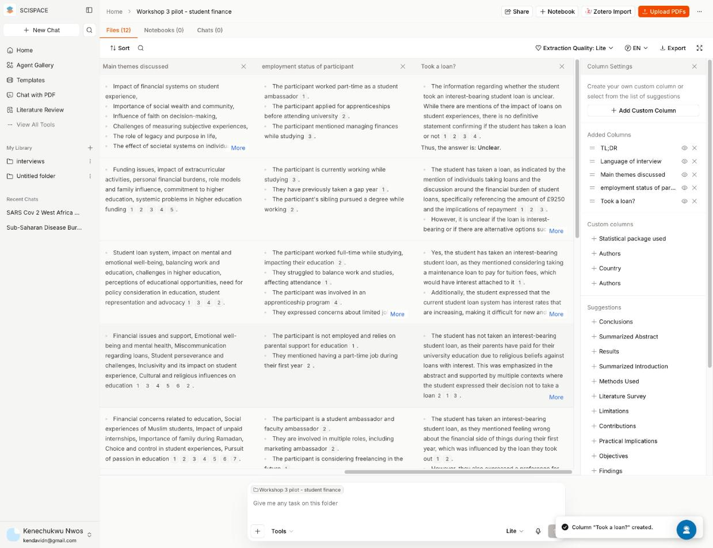
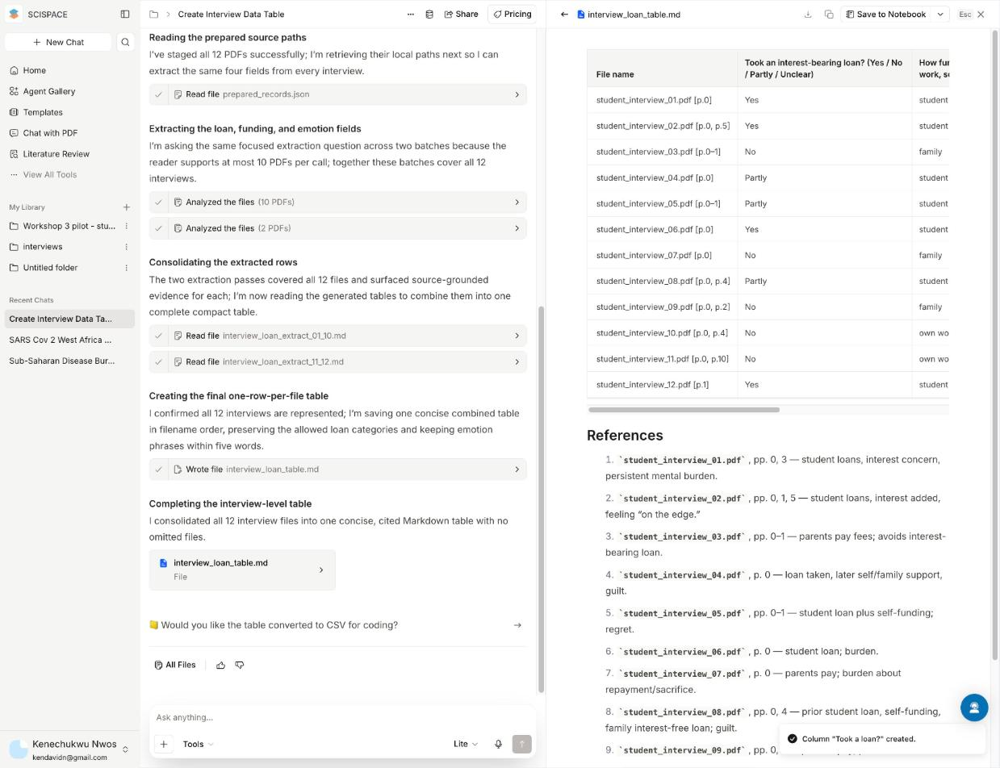

# Introduction

Welcome. In this workshop you will use AI to read a stack of documents, pull the same few facts out of each one, and then check whether the AI was right.

This is the same idea as the Google Sheets prework: ask one clear question of one row at a time, instead of handing a model a huge pile and hoping it keeps every detail. Today the "rows" are whole PDFs.

You will:

1. Pick **one** collection: 20 research papers, or 20 interview transcripts.
2. Upload that collection to **SciSpace** and ask it for a short table. The columns are already written for you.
3. Copy that table into **ChatGPT or another paid AI tool you choose** and run the analysis that is already written for your collection.
4. Check 3 documents by hand against the original PDFs.
5. Write a short report. The reflection is yours, not the model's.

::: callout-note
## Prework, briefly

This workshop assumes you have seen the prework on calling an LLM from Google Sheets with OpenRouter: [Using LLM APIs with OpenRouter and Google Sheets](https://vimeo.com/1086807545?share=copy&fl=sv&fe=ci){target="_blank"}. You do not redo that exercise today.

If the video mentions `google/gemini-2.5-flash-preview`, use `google/gemini-2.5-flash`. The preview model is no longer on OpenRouter.

The point to carry forward: a spreadsheet formula that sends **one cell** to the model is more reliable than one giant prompt. SciSpace is the document version of that pattern. It reads **one PDF at a time** and asks **the same question of each file**.
:::

::: callout-note
## Why not upload all 20 files straight into ChatGPT?

You can try, and a strong chat tool will often produce something that looks finished. With many long PDFs it also tends to skim, skip a file, or blend details from two documents into one sentence. Build the table first. Use the chat tool on the **table**, where each document is already one row.
:::

## Your report should contain

1. **Introduction** (2-3 sentences): which collection you chose, and what you wanted to find out.
2. **Extraction table**: the table SciSpace produced (a screenshot or a pasted table is fine).
3. **One chart and interpretation**: the chart specified for your collection, plus 3-5 sentences on what it shows. Say that the sample is small and that an AI extracted the numbers.
4. **Accuracy check**: a small table for the 3 documents you checked by hand (Part 3).
5. **Reflection** (1-2 paragraphs, written by you): What did the AI get right? What did it get wrong? Would you trust this for real work? What would you do differently?

As in Workshop 2, we are not grading technical precision. We check that these pieces are present and that the reflection is in your own words.

------------------------------------------------------------------------

# Part 0: Choose Your Collection

Pick **one**. You do not need to be a specialist in the topic.

::: callout-tip
Both collections are public, which is why we can use them here. **Do not upload confidential documents** (for example your own organisation's interview transcripts or internal reports) to a free or paid AI tool unless you have permission. That rule is part of the workshop.
:::

## Option A: Literature review. Does a break from social media, screens, or the internet change wellbeing?

Twenty studies and reviews. Most ask people to quit or limit social media. Several go further and block mobile internet, cut household screen time, or restrict digital media more broadly. The results do not all agree, which is why a table is useful.

Download: [papers_break_deactivation_grok47_k7m2.zip](data_grok47_k7m2/papers_break_deactivation_grok47_k7m2.zip)

| File | What it is |
|---|---|
| `allcott_2020_facebook_deactivation.pdf` | Allcott, Braghieri, Eichmeyer, and Gentzkow (2020). Deactivate Facebook for 4 weeks before the 2018 US midterms. |
| `allcott_2025_fb_ig_deactivation.pdf` | Allcott, Gentzkow, and colleagues (2025). Deactivate Facebook or Instagram for 6 weeks before the 2020 US election. |
| `lambert_2022_one_week_break.pdf` | Lambert and colleagues (2022). One-week break from social media, UK. |
| `collis_2022_restricting_social_media_students.pdf` | Collis and Eggers (2022). Cap Facebook, Instagram, and Snapchat at 10 minutes a day, Denmark. |
| `przybylski_2021_short_break_three_experiments.pdf` | Przybylski and colleagues (2021). One-day breaks, UK, US, and Hong Kong. |
| `hanley_2019_sns_vacation.pdf` | Hanley, Watt, and Coventry (2019). One-week vacation from Facebook and Instagram. |
| `brown_kuss_2020_seven_day_abstinence.pdf` | Brown and Kuss (2020). Seven-day social media abstinence. |
| `vanwezel_2021_seven_day_restriction.pdf` | van Wezel, Abrahamse, and Vanden Abeele (2021). Seven-day cut in social media screen time. |
| `faulhaber_2023_limit_30min.pdf` | Faulhaber, Lee, and Gentile (2023). Self-monitored limit of 30 minutes a day for 2 weeks, USA. |
| `coyne_2023_two_week_detox.pdf` | Coyne and Woodruff (2023). Two-week social media limit of 30 minutes a day. |
| `dehesselle_montag_2024_14day_abstinence.pdf` | de Hesselle and Montag (2024). 14-day social media abstinence. |
| `schmidt_persson_2024_family_screen_reduction.pdf` | Schmidt-Persson and colleagues (2024). Two-week reduction in household screen media, Denmark. |
| `walsh_2024_restrict_digital_media.pdf` | Walsh, Regan, Okabe-Miyamoto, and Lyubomirsky (2024). Eight days restricting digital media, social media, or neither. |
| `castelo_2025_block_mobile_internet.pdf` | Castelo, Kushlev, Ward, Esterman, and Reiner (2025). Block mobile internet on smartphones for 2 weeks. Calls and texts stay on. |
| `farrukh_2025_digital_detox.pdf` | Farrukh and colleagues (2025). Two-week digital detox in medical students. |
| `calvert_2025_youth_detox.pdf` | Calvert and colleagues (2025). Social media detox and youth mental health. |
| `lemahieu_2025_abstinence_meta.pdf` | Lemahieu and colleagues (2025). Meta-analysis of social media abstinence and wellbeing. |
| `liu_2025_detox_meta.pdf` | Liu and colleagues (2025). Meta-analysis of social media detox trials. |
| `may_2025_depression_meta.pdf` | May, Malouff, and Meynadier (2025). Meta-analysis of reduced social media use and depression symptoms. |
| `ramadhan_2024_detox_review.pdf` | Ramadhan and colleagues (2024). Systematic review and meta-analysis of digital social media detox. |

Four of these are reviews rather than a single experiment: Lemahieu, Liu, May, and Ramadhan. For a review, "sample size" means the number of participants or studies the review actually analysed, and "wellbeing result" means the **overall** conclusion, not one study inside it.

### Columns for Option A

Use these names and instructions. Do not invent a different set.

| Column name | What SciSpace should answer |
|---|---|
| Country | Which country or countries were participants from? For a review, list the main countries if stated, otherwise "Multiple". Country names only. |
| Sample size | How many participants were analysed? For a review, the total participants across included studies if stated, otherwise the number of studies. A single number only. |
| Break type and length | What were people asked to do (quit, limit, or block internet or screens), on which platforms or devices, and for how long? Under 15 words. |
| Wellbeing result | Did the break improve wellbeing overall? Exactly one of: Improved, No clear effect, Mixed, Worse. |
| Key caveat | The main limitation, in under 20 words. |

### Analysis for Option A

One grouped bar chart: how many studies fall into each wellbeing result (Improved, No clear effect, Mixed, Worse), split by whether the break was **social media only** or a **broader internet or screen block**. In the interpretation, say whether those two groups look different, and say that four of the rows are reviews.

## Option B: Qualitative analysis. Refugee food insecurity in Utah

Twenty interviews with refugees in Utah about getting food after resettlement: cost, transport, work, food assistance, and how things change over time. The interviews were conducted in Arabic, Dari, English, and Kinyarwanda and translated into English. The language is in the file name.

The published study has 36 interviews. This workshop uses 20 so the upload stays manageable: all 6 Dari interviews, all 4 English interviews, 5 Arabic, and 5 Kinyarwanda.

Download: [qual_utah_refugee_food_20_grok47_k7m2.zip](data_grok47_k7m2/qual_utah_refugee_food_20_grok47_k7m2.zip)

Source: a 2025 University of Utah study in [*PLOS ONE*](https://journals.plos.org/plosone/article?id=10.1371/journal.pone.0327645){target="_blank"}. Transcripts from [figshare](https://figshare.com/articles/dataset/De-identified_English_Transcripts_of_36_interviews/29318549){target="_blank"}, CC BY 4.0. We converted the Word files to PDF and kept this subset.

### Columns for Option B

| Column name | What SciSpace should answer |
|---|---|
| Main barriers | Which barriers to getting food does the participant mention? Choose any of: cost, transport, language, work schedule, benefits problems, cultural foods unavailable, none. List only the matching words. |
| Food help used | Which sources of food help does the participant mention using? Choose any of: SNAP/food stamps, WIC, food pantry, resettlement agency, school meals, community or religious group, none. List only the matching words. |
| Coping strategy | What does the household do when food runs short? Under 15 words. |
| Change over time | Has the participant's food situation improved, worsened, or stayed the same since arriving? One of: Improved, Worsened, Same, Unclear. |
| Key quote | One short direct quote, under 25 words, that best captures their experience with food. |

### Analysis for Option B

One bar chart of how many interviews mention each food barrier. In the interpretation, also say which sources of food help come up most often. Note that this is 20 of 36 interviews, the codes were extracted by AI, and a person can mention more than one barrier.

------------------------------------------------------------------------

# Part 1: Extract a Table with SciSpace

## Part 1A. Set Up SciSpace

1. Go to [scispace.com](https://scispace.com){target="_blank"} and sign up for a free account (Google sign-in is fine).
2. Download the zip for your collection and unzip it. On Windows: right-click, Extract All. On Mac: double-click the zip.

::: callout-note
## What to expect from the free plan

On 17 October 2026 the public Extract Data page was still at [scispace.com/extract-data](https://scispace.com/extract-data){target="_blank"}, with an **Upload PDF** button. The marketing FAQ on that page said custom columns can go up to 50. In a free-plan pilot on 14 October 2026, the practical limits were tighter:

- About 4-6 credits to upload 12 interviews and build a table, against a monthly pool of about 100 credits.
- A low cap on custom columns, with an "Add up to 50 columns with paid plans" pop-up.
- No file export. Export is a paid feature, so you will copy the table out (Part 1E).

If a column limit appears, close the pop-up. The table you analyse comes from the folder chat in Part 1D, not from filling every custom column.

SciSpace changes its screens. Yours may not match the pictures exactly.
:::

## Part 1B. Upload the Documents

1. Open [scispace.com/extract-data](https://scispace.com/extract-data){target="_blank"}.

    {width="550"}

2. Click **Upload PDF** and select **all** the PDFs in your unzipped folder.
3. When SciSpace asks for a folder, click **+ New Folder**, name it "Workshop 3", select it, and click **Upload**.

    {width="400"}

4. You land on a table with one row per file. Give it a minute or two.

    {width="650"}

## Part 1C. Optional: Try One Custom Column

This step is so you can see what a custom column does. It is not the table you will chart.

1. In **Column Settings**, click **+ Add Custom Column**.
2. Use the column name `Wellbeing result` (Option A) or `Change over time` (Option B), paste that row's instruction from Part 0, and click **Create**.

    {width="400"}

3. Read a few cells after they fill in.

    {width="650"}

You will probably see two things:

- Default columns are written for journal articles. On interviews they often say "Not addressed in the paper".
- Even a prompt that says "exactly one of: Improved, No clear effect, Mixed, Worse" often comes back as a paragraph with citations.

That is useful for checking, and awkward to chart. Part 1D asks for the short table.

## Part 1D. Ask the Folder Chat for the Compact Table

At the bottom of the folder, the chat box says something like **"Give me any task on this folder"**. Paste the prompt for your option. Do not rewrite the columns.

**Option A**

```
Make a table with one row per PDF in this folder and these columns:
File name | Country (country names only; for a review write Multiple if no single country) | Sample size (one number only: participants analysed, or for a review the total participants if stated, otherwise the number of studies) | Break type and length (quit, limit, or block internet/screens; platforms or devices; duration; under 15 words) | Wellbeing result (exactly one of: Improved, No clear effect, Mixed, Worse) | Key caveat (under 20 words)
Keep each cell very short. Do not skip any file. There should be 20 rows.
```

**Option B**

```
Make a table with one row per interview PDF in this folder and these columns:
File name | Main barriers (only words from this list: cost, transport, language, work schedule, benefits problems, cultural foods unavailable, none) | Food help used (only words from this list: SNAP/food stamps, WIC, food pantry, resettlement agency, school meals, community or religious group, none) | Coping strategy (under 15 words) | Change over time (exactly one of: Improved, Worsened, Same, Unclear) | Key quote (one direct quote under 25 words)
Keep each cell very short. Do not skip any file. There should be 20 rows.
```

1. Press Enter. The agent shows its steps. For 12 interviews this took about 2-3 minutes in our pilot. Twenty files will take longer. If it stops early, reply: "Continue until every file has a row."
2. Open the table it creates. You want one short cell per column, not a paragraph.

    {width="650"}

3. Count the rows. If a file is missing, reply: "File X is missing. Please add a row for it."

::: callout-tip
## Why the prompts are so strict

"A single number only", "exactly one of", and "under 15 words" are there so the next tool can count. An explicit "Unclear" or "none" gives the model a way to admit a gap instead of inventing a fact.
:::

## Part 1E. Copy the Table Out

1. Select the whole table in the preview and copy it (Ctrl+C or Cmd+C). There may also be a copy icon on the preview.
2. Paste into a new Google Sheet ([sheets.new](https://sheets.new){target="_blank"}).
3. Check that each document is its own row. If the paste is messy, paste the same text into your paid AI tool and ask it to return a clean table with one row per document, then paste that into the sheet.
4. Take a **screenshot** of the SciSpace table for your report.
5. Download the sheet as CSV: `File → Download → Comma Separated Values (.csv)`.

------------------------------------------------------------------------

# Part 2: Analyse the Table in a Paid AI Tool

Everyone does this step in a paid chat or coding tool. ChatGPT is the default. Claude, Gemini, or Cursor are fine if you already pay for one of them. Use a thinking or reasoning model if your tool has one, as in Workshop 2.

If you cannot access a paid model, email an instructor and we will add you to the course ChatGPT workspace for a month.

1. Start a new chat.
2. Upload the CSV.
3. Paste the prompt for your option.

**Option A**

```
I have uploaded a CSV. An AI tool extracted it from 20 papers and reviews about breaks from social media, screens, or mobile internet. Each row is one document.

Columns: File name, Country, Sample size, Break type and length, Wellbeing result, Key caveat.

Please:
1. Clean the data and tell me what you changed. Wellbeing result must be exactly one of: Improved, No clear effect, Mixed, Worse. Make Sample size numeric.
2. Add a column Break group with exactly one of: Social media only, Internet or screen block. Use Internet or screen block when the study blocks mobile internet, cuts household or general screen time, or restricts digital media beyond social media apps. Use Social media only otherwise. Show me the coding so I can disagree.
3. Make ONE grouped bar chart: count of documents in each Wellbeing result, split by Break group.
4. Write 3 to 5 sentences interpreting the chart. Note that the sample is 20 documents, four of them are reviews, and the cells were extracted by AI.
```

**Option B**

```
I have uploaded a CSV. An AI tool extracted it from 20 interviews about refugee food insecurity in Utah. Each row is one interview. A person can mention more than one barrier.

Columns: File name, Main barriers, Food help used, Coping strategy, Change over time, Key quote.

Please:
1. Clean the data and tell me what you changed. Split the barrier lists and the food-help lists so each item can be counted.
2. Make ONE bar chart of how many interviews mention each food barrier.
3. In the text, also say which food-help sources are mentioned most often. Do not make a second chart unless I ask.
4. Write 3 to 5 sentences interpreting the chart. Note that this is 20 of 36 interviews from the original study, and the codes were extracted by AI.
```

4. Read the chart before you keep it. Ask for clearer titles, labels, and colours if you need them. Download the chart or screenshot it.
5. If the model changed a wellbeing label or a barrier word, and you disagree, change it back and say so in the interpretation.

------------------------------------------------------------------------

# Part 3: Check Three Documents Yourself

The table will look tidy. That is not the same as being right.

1. Pick **3 documents**. Include one where the answer looked surprising or vague.
2. Open each original PDF. Use Ctrl+F or Cmd+F. Find the answer to each column yourself.
3. Put a table like this in the report:

    | Document | Column | AI answer | Correct? (Yes / Partly / No) | Note |
    |---|---|---|---|---|
    | (your file) | (your column) | (what the AI wrote) | No | Say what the PDF actually says |
    | ... | ... | ... | ... | ... |

4. Count how many AI answers were fully correct, out of how many cells you checked.

For Option A, reviews are a useful check. A model will sometimes report one study from inside the review as if that were the whole paper.

For Option B, check the quote against the transcript. A quote that is not in the file is a fabricated quote, even if it sounds plausible.

------------------------------------------------------------------------

# Part 4: Submission

Assemble the report in Word, Google Docs, or another word processor. If you used Cursor, a rendered HTML or PDF is fine, as long as the five pieces are in it.

1. Introduction
2. Extraction table (screenshot or pasted)
3. One chart and interpretation
4. Accuracy check, with your count of fully correct answers
5. Reflection, in your own words

Submit a **single PDF or HTML file**. You do not submit the Google Sheet or the SciSpace folder.

------------------------------------------------------------------------

# Part 5: Optional. Add the Report to Your GitHub Pages Portfolio

Upload the report to your portfolio repository and ask ChatGPT or Gemini to add a project link to `index.html`, as in Workshop 2. Describe the project as:

```
Workshop 3: AI-Assisted Document Extraction. I used SciSpace to extract
a table from 20 [papers / interviews] about [social media and internet
breaks / refugee food insecurity in Utah], analysed that table in a paid
AI tool, and checked three documents by hand.
```

------------------------------------------------------------------------

# Data Sources and Licences

- **Option A.** Each paper stays under its publisher's licence. The files are the open versions from the publisher, the author's university, NBER, or PubMed Central.
- **Option B.** Sharareh, N. (2025), *De-identified, English Transcripts of 36 interviews*, figshare, [doi:10.6084/m9.figshare.29318549](https://doi.org/10.6084/m9.figshare.29318549){target="_blank"}. CC BY 4.0. This folder is a 20-interview subset, converted from DOCX to PDF.
