## Introduction

Welcome! In this assignment, you'll create an LLM-powered chatbot using Botpress and embed it into your portfolio website that you created in a previous session.

Your completed chatbot will be able to:

1.  **Answer CV/Resume Questions** - Provide information about your background using uploaded CV data
2.  **Share Course Information** - Provide info about the Graph Courses GenAI syllabus and curriculum details
3.  **Collect Visitor Information** - Gather names and emails from interested visitors for showcase day registration

------------------------------------------------------------------------

# Part 1: Setting Up Your Botpress Account and Creating Your Bot

Our first task is to set up a Botpress account and create a new bot.

Note that the Botpress interface changes from time to time, so the screenshots may not be exactly the same as the ones in the instructions.

Also note that the current [free plan](https://botpress.com/pricing/) allows up to 100 conversations per month. This should be enough for our course chatbots. 

But for serious use later on, you may need to upgrade your plan. 

1.  **Create Your Botpress Account:**

    -   Go to [botpress.com](https://botpress.com/){target="_blank"}

    -   Sign up for a free account using your email.

    -   You may be asked a bunch of onboarding questions. Your answers here do not matter too much. You can fill in quick responses. For example, when asked "your main use case", you can enter "info chatbot" within the "Something else? Tell us what you're building" field:

        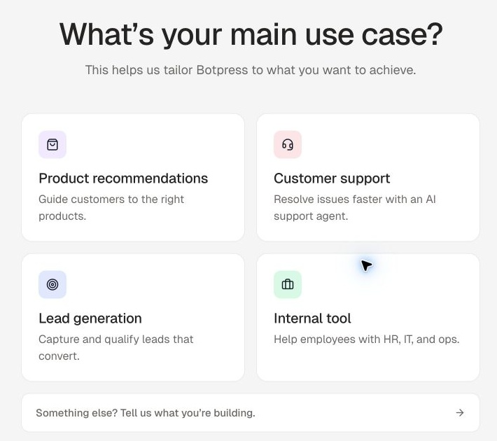{width="500"}

        For your number of conversations you can enter "1 to 100".

    -   The signup flow may open Botpress Viber, which is an automatic builder. We will not use this. Click the back arrow at the top right of the page to return to the workspace,

        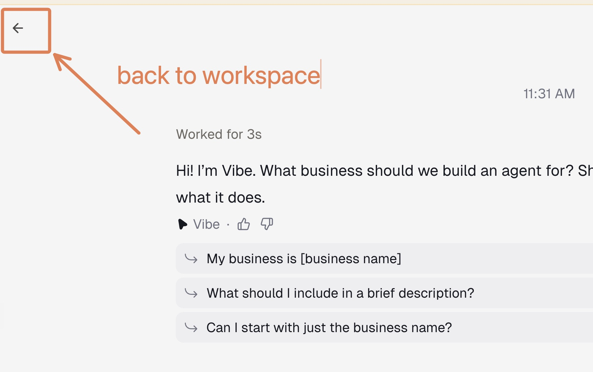{width="100"}

        then click "Agents" on the sidebar.

        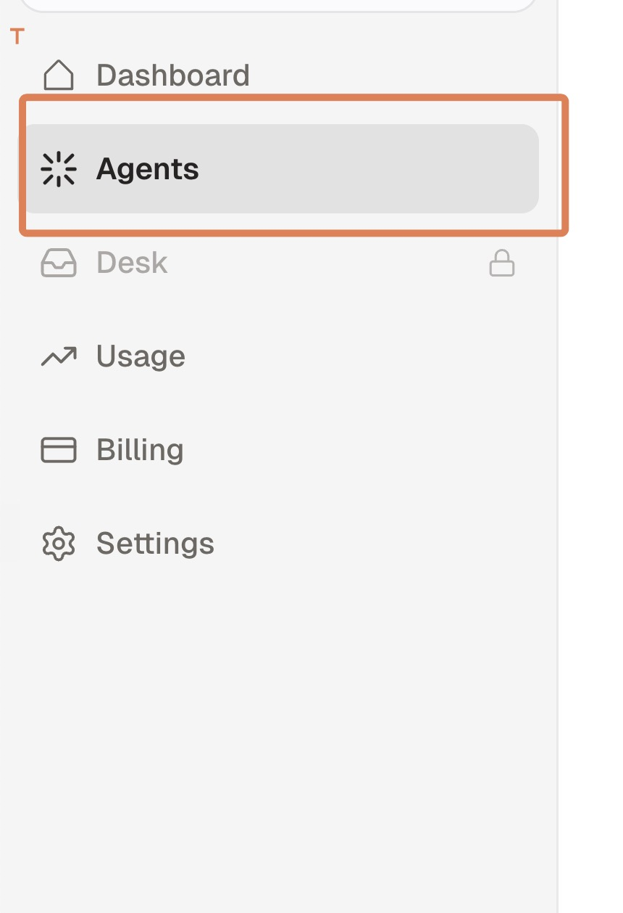{width="100"}

        Open the dropdown beside "Create agent" and select "Visual Editor" to open Botpress Studio.

        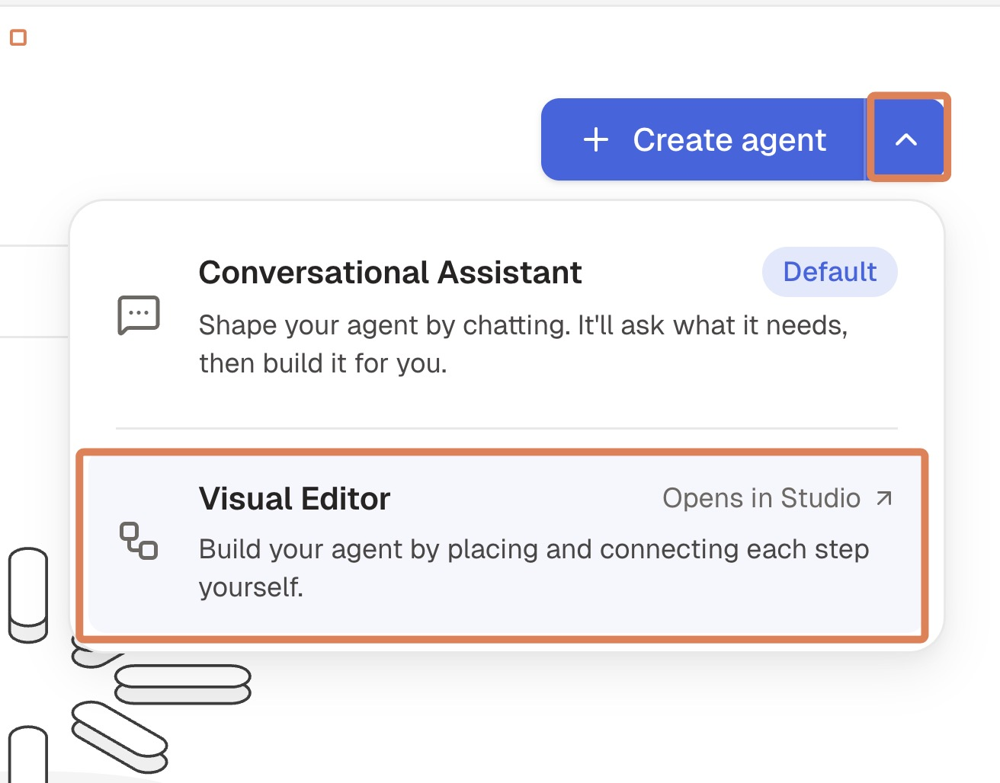{width="440"}


# Part 2: Setting Up the Bot Instructions

You now need to give an agent prompt that the LLM will use as context to understand how it should behave.

1.  **Set Bot Instructions:**

    -   In the main configuration area, find the "Instructions" field

    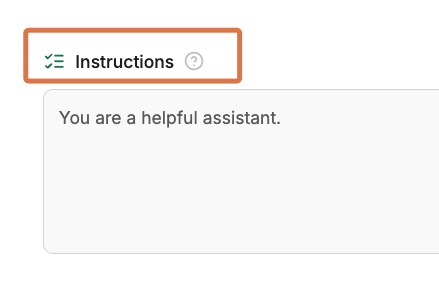

    -   Enter instructions like the below:

```{text}
You are a portfolio assistant for a Generative AI course student. Your main tasks are:

- Answer questions about the student's CV and background using the knowledge base
- Provide information about the Graph Courses GenAI syllabus and curriculum based on your knowledge base
- After answering the user's query, politely ask them whether they might be interested in our upcoming showcase event. These take place on:

- Sunday 15 November 2026, 11:00–13:00 GMT
- Wednesday 18 November 2026, 15:00–17:00 GMT

- If they express interest, collect their name and email for registration and record those in the Attendees table tool.
- Try to be helpful while staying focused on these core topics. For other topics, politely decline to answer. 
```

# Part 3: Set up the Knowledge Base

Our next task is to set up a knowledge base for the bot to use to answer questions. Botpress searches the knowledge base for relevant information, so the uploaded documents do not all need to fit within the LLM’s context window.

1.  **Navigate to Knowledge Base:**

    -   Find the "Knowledge bases" section under the "Instructions" section and click the button to create a new knowledge base.
    -   Drag and drop your CV into the knowledge base. If you do not want your personal information online, use a sample CV from the internet, or write a fictional CV and save it as a plain text file.

        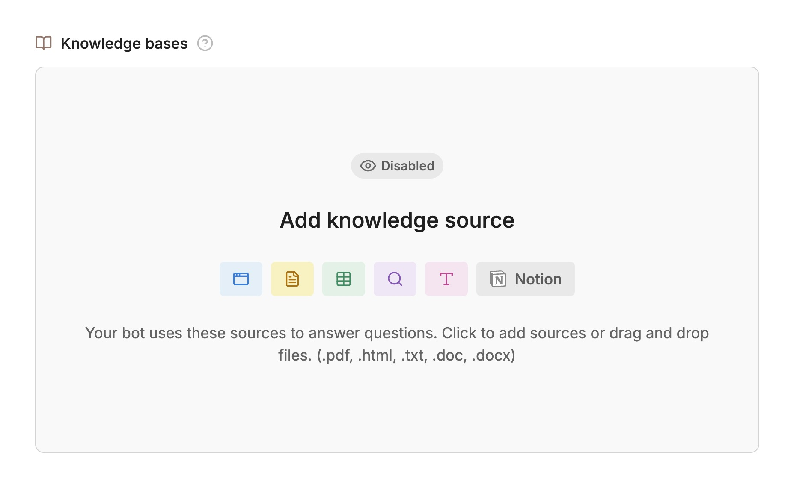{width="560"}

    -   Download the syllabus from [https://drive.google.com/file/d/1-BhMyhSU77Zfx9_TEkhQwq_DBAUlxs9z/view](https://drive.google.com/file/d/1-BhMyhSU77Zfx9_TEkhQwq_DBAUlxs9z/view){target="_blank"} and upload it to the knowledge base as well.


# Part 4: Set Up Data Collection

Next, we will create a table to store the data of the attendees of the showcase event.

1.  **Create Attendees Table Structure:**

    -   On the Botpress sidebar, click on the Tables icon.

    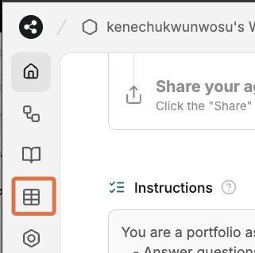

    -   Click on the New Table button at the top left and call it something like "Attendees", then click to Save.

    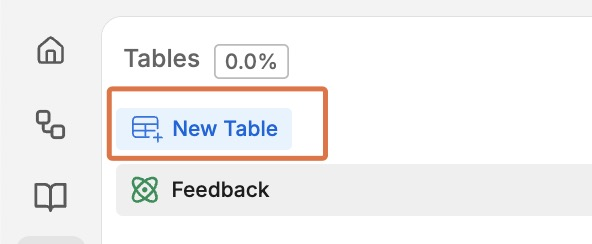{width="346"}

    -   Click the new column icon to add the following two columns, leaving all settings as default
        -   Name
        -   Email

    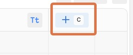

2.  **Configure Collection:**

Now that we have created the table, we need to allow the bot to use this table to store data.

-   Return to the main configuration area, by clicking on the "Home" icon on the left sidebar

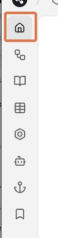

-   Scroll down to the Tools section

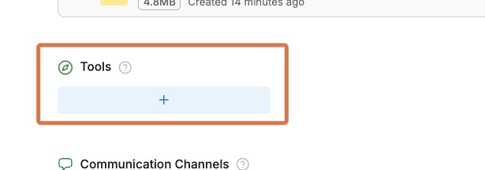{width="436"}

-   Click on Tables then the Attendees table, then "Create Rows". This gives your bot the ability to create rows in that table.

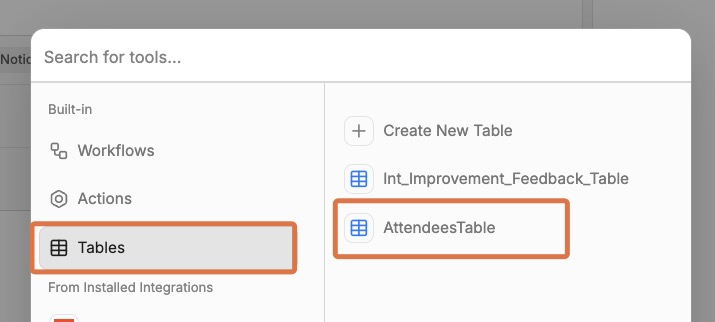{width="468"}

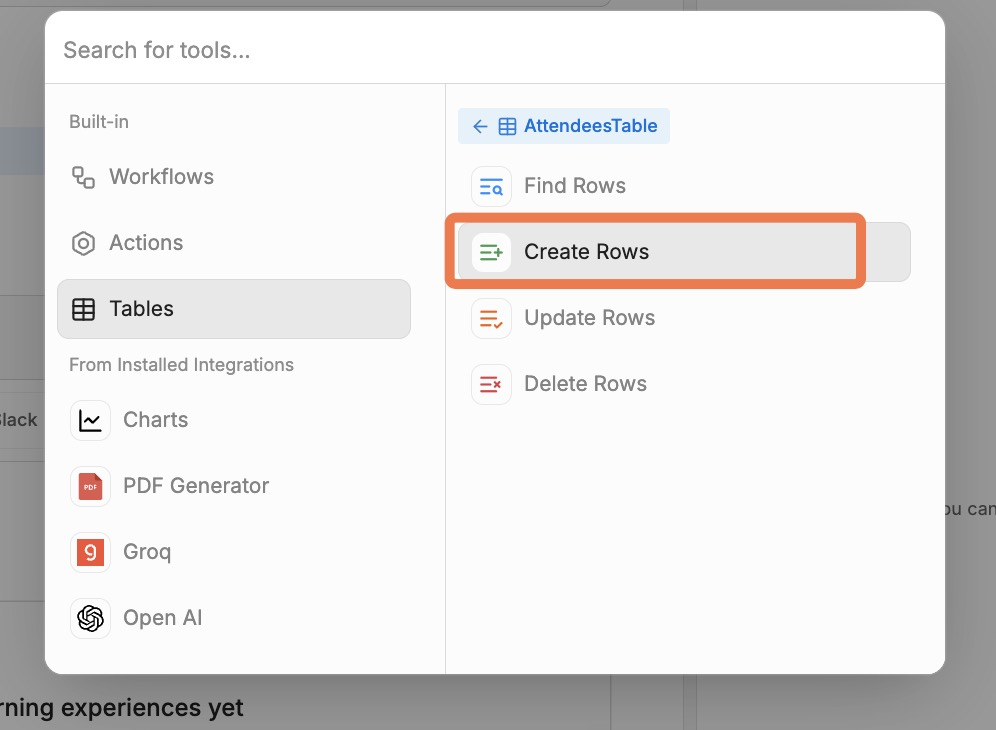{width="468"}

# Part 5: Testing and Publishing Your Bot

1.  **Use the Test Chat:**

    -   The Botpress interface has a test chat panel on the right side of the screen
    -   Try asking questions about:
        -   Your background ("Tell me about the educational background of \[your name\]")
        -   Course content ("What topics are covered in the GenAI course?")
    -   The bot should interrupt at some point to ask if you might be interested in the event.
    -   Give your email and name, then check the Attendees table to see if the bot was successful in adding your information.

        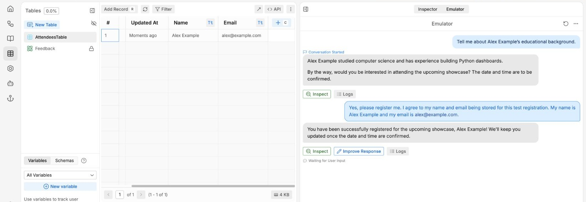{width="660"}

2.  **Publish:**

    -   Click the "Publish" button in the top-right corner, then "Publish changes"
    -   Wait for the publishing process to complete

    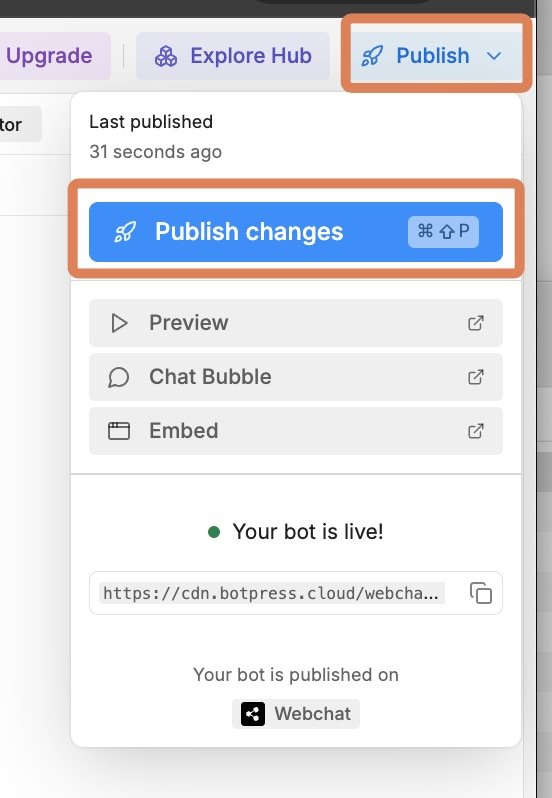{width="340"}

3.  **Get Embedding Code:**

    -   After publishing, click on the "Chat Bubble" icon under the Publish menu.

    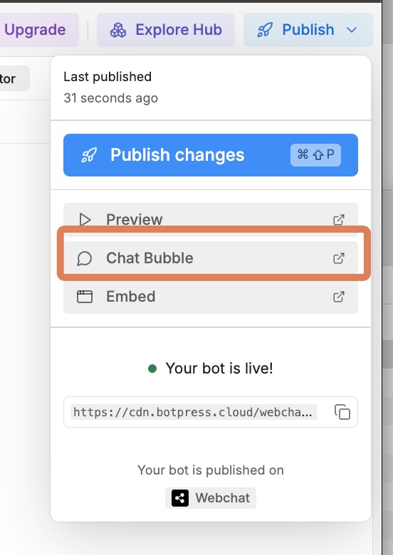{width="340"}

    -   You'll be taken to a section where you can edit the chat bubble settings.

    -   On the "Deploy Settings" page, copy the code under "Embed Code". 

    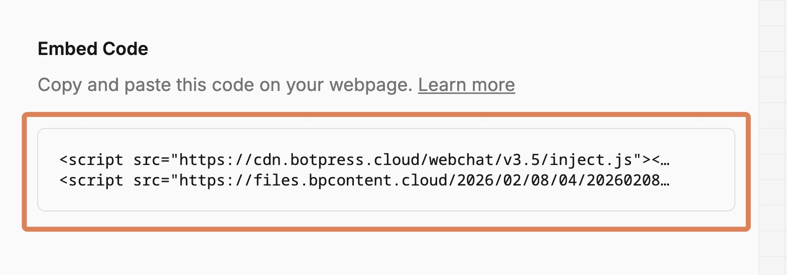{width="560"}

    -   Side note: Later you can come back to the "bot appearance" section to customize how your bot looks.

    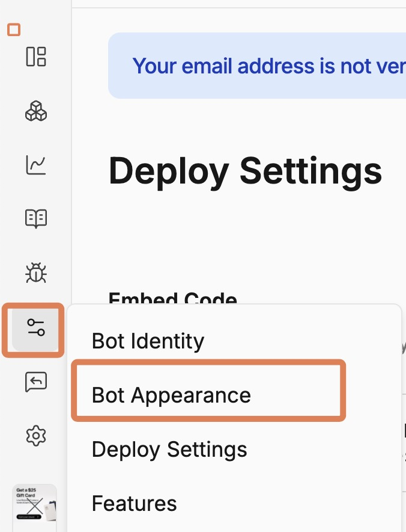{width="343"}

# Part 6: Embedding Your Bot on Your Website

Now, we need to add this code to your portfolio website, so that a chat bubble appears at the bottom right of the page.

## Part 6A: Add Bot to Your Portfolio

1.  **Navigate to Your GitHub Repository:**

    -   Go to [github.com](https://github.com){target="_blank"}. Click on your profile icon at the top right, then click on "Your repositories".

        {width="324"}

    -   Locate and click on your portfolio repository (it should be called something like `graph-ai-portfolio`).

2.  **Open Your `index.html` File for Editing:**

    -   In your repository, click on the `index.html` file.

        {width="374"}

    -   Click the **edit file** (pencil) button at the top right of the file view.

        {width="452"}

3.  **Insert the Bot Code:**

    -   Next, add the Webchat embed code to the head section of your website’s HTML. For example:

        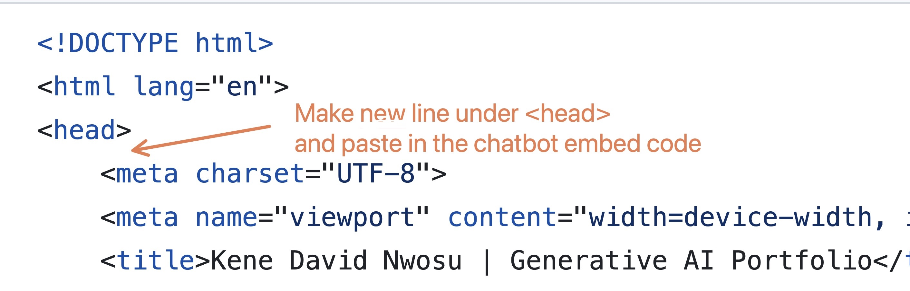{width="456"}

    -   If you do not feel comfortable making this change yourself, you can ask an LLM to do it for you.

4.  **Commit and Deploy:**

    -   Save your changes to the `index.html` file
    -   Commit the changes to your GitHub repository
    -   Your live site will update automatically if GitHub Pages is configured to deploy your changes (this may take up to 10 minutes)
    -   You can track the status of your deployment by clicking on the "Actions" tab in the menu of the GitHub repository page
    -   NOTE: Even after the site is done deploying, you may need to refresh the page a few times to see the bot appear, because your browser may be loading a cached version of the page.

## Part 6B: Test Live Integration

1.  **Visit Your Live Site:**
    -   Go to your GitHub Pages URL
    -   Look for the chat bubble (usually appears in the bottom-right corner)
2.  **Test Full Functionality:**
    -   Try the same tests you did before, but now on your live website
    -   Ensure the bot loads properly and responds correctly
    -   Verify the registration flow works in the live environment
3.  **Making changes to your bot:**
    -   WATCH OUT: If you make any changes to your bot, be sure to click on "Publish" again in the top-right corner to save your changes.

# Part 7: Submission

To submit:

-   Upload a screenshot of your chatbot ‘in action’ on your portfolio website in the upload box.
-   Paste a link to your website in the comments section.