# Introduction

In this workshop, you'll practice building an automation with ChatGPT scheduled tasks. 

You'll embed a Google Form on your portfolio website that allows visitors to request a consultation. Then you'll use ChatGPT scheduled tasks to check the form for new submissions, research the potential client's organization, and email you a report on GenAI opportunities.

::: callout-tip
## Consulting? Me?

You may be thinking "I'm not qualified to be a GenAI consultant!". But by now you have a decent understanding of how large language models work, what they do well, and what many of their limitations are. 

You're probably in the **top 5% of people** in terms of GenAI literacy in most fields. 

:::

::: callout-note
## Claude as an alternative

If you have a paid account with Claude you can also use it for this workshop exercise, but you'll have to translate the instructions we give for ChatGPT here into the Claude equivalent.

Claude will also not work for the optional PubMed challenge as the PubMed RSS URL is not on Claude's allowed list of domains.

:::

------------------------------------------------------------------------


# Part 1: Connecting ChatGPT to Google

## 1.1 Recommended: Create a Separate Google Account

In this workshop, you will need to give ChatGPT access to a Google account so it can read form responses and send emails automatically on a schedule. 

The access ChatGPT asks for is broad. It covers all your Google Drive files, Docs, Sheets and Slides, your contacts and calendar, and the ability to send emails from your Gmail account.

We therefore recommend creating a brand-new, separate Google account just for AI experiments (for example, `kene.assistant@gmail.com`), rather than connecting your personal or work Google account.

Note that this does not mean you need a new ChatGPT account. Rather you will use your regular ChatGPT account (for example, `kene.regular.email@xyz.com`) to connect to the new Google AI assistant Gmail account you create.

Please ask an instructor for clarity on this if you are unsure.

## 1.2 Connect Google Drive and Gmail

1.  Open [ChatGPT](https://chatgpt.com){target="_blank"} in your browser and log in with your regular ChatGPT account (for example, `kene.regular.email@xyz.com`). Note that this needs to be a paid account. You should have received paid access as part of a previous workshop. Let us know if you have not.


2. Click **Plugins** in the sidebar.

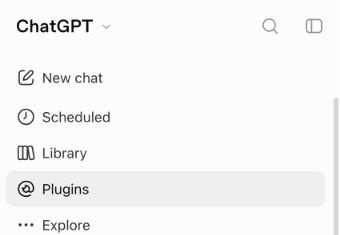{fig-alt="ChatGPT sidebar with Plugins button" width="230"}

In some versions of ChatGPT, **Plugins** appears as an icon in the narrow left-hand bar instead:

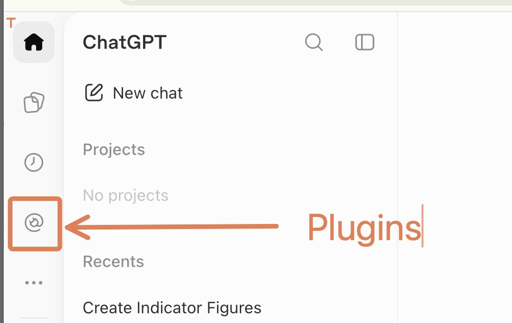{fig-alt="ChatGPT sidebar with the Plugins icon highlighted" width="500"}

3.  Find **Google Drive** (under **Popular**, or search for it) and click the **+** next to it.

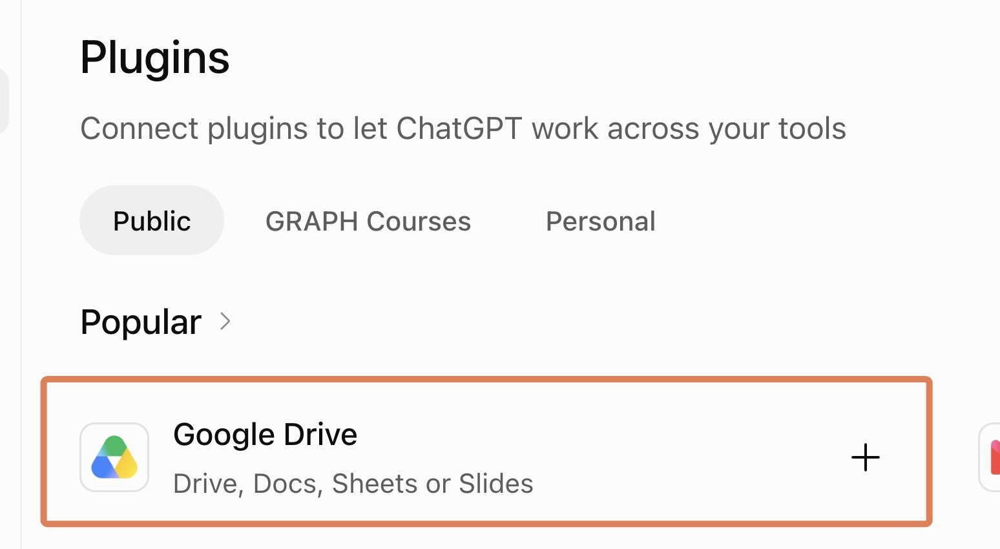{fig-alt="Plugins page with the Google Drive plugin and its plus button highlighted" width="620"}

4.  A window will list the Google plugins to install: Google Drive, Gmail, Google Calendar and Google Contacts. Leave them all switched on. This connects Gmail at the same time, so you don't need to add it separately. Click **Continue to Google**.

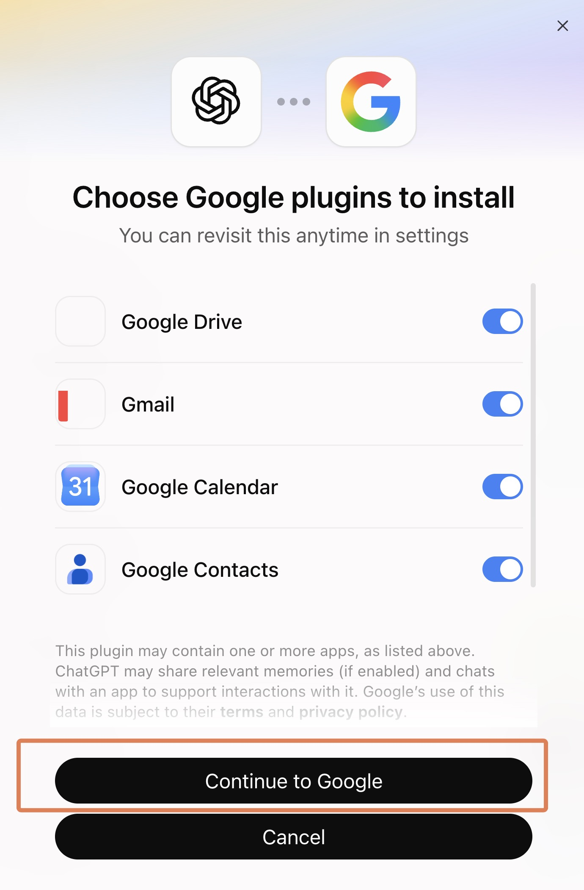{fig-alt="Choose Google plugins to install window with Drive, Gmail, Calendar and Contacts switched on and Continue to Google highlighted" width="420"}

5.  Choose your AI assistant Google account (for example, `kene.assistant@gmail.com`). If it isn't listed, click **Use another account** and sign in to it.

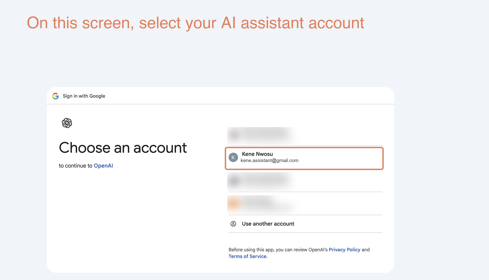{fig-alt="Google account chooser with a note to select the AI assistant account" width="620"}

6.  On the next screen, tick **Select all** so ChatGPT gets every permission listed, then scroll down and click **Continue**.

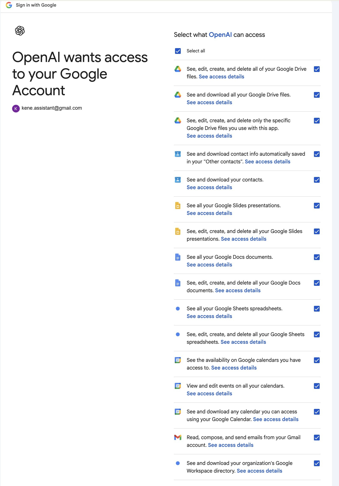{fig-alt="Google access request with Select all and every permission ticked" width="520"}

::: callout-note
If you had already connected this plugin before, you'll need to click **Manage** to check the account. 
:::

::: callout-note
## If your scheduled task asks for approval before sending email

Some versions of ChatGPT let you set how much each app can do without asking you first. If your test run in Part 3 stops to ask for approval before sending the email, look for a **Permissions** setting for Gmail and choose **Allow all actions** (sometimes shortened to **Allow all**). If you can't find this setting, you can skip it. Ask your instructor if the email still doesn't send.
:::

------------------------------------------------------------------------

# Part 2: Setting Up Your Google Form and Data Collection

## Create Your Project Folder

1.  In your browser, navigate to [drive.google.com](https://drive.google.com/){target="_blank"}

2.  Click the profile picture at the top right and check that you're signed in to your AI assistant account (for example, `kene.assistant@gmail.com`). If not, switch to it. The folder, form and spreadsheet must all be in the same Google account you connected to ChatGPT.

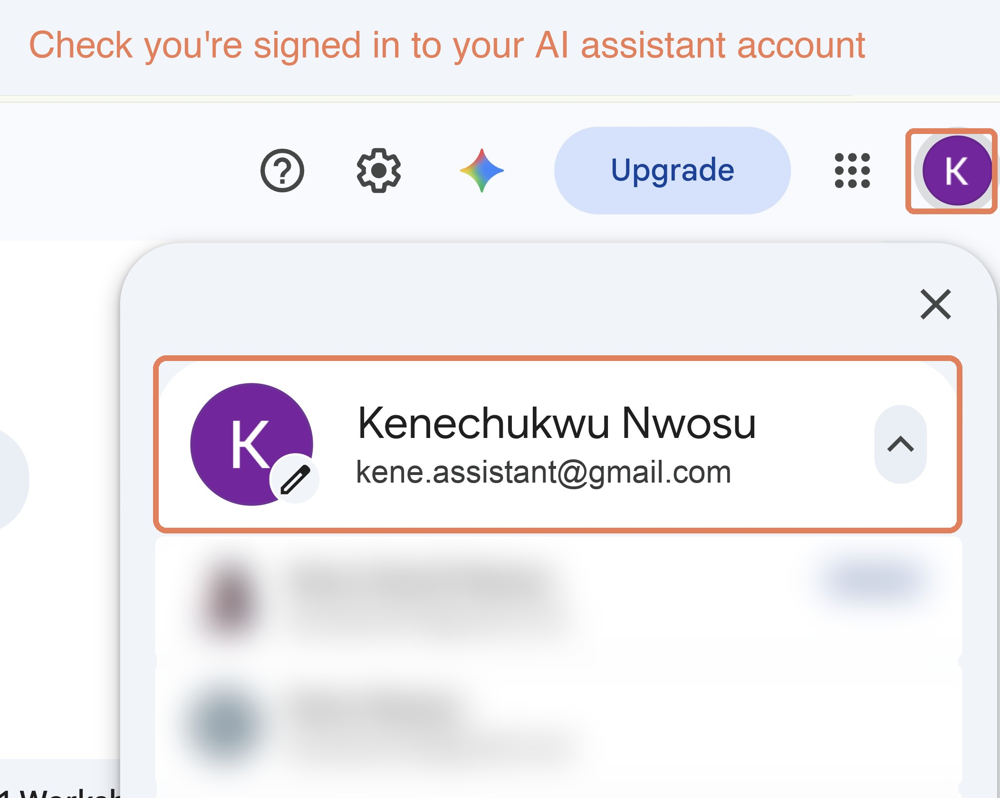{fig-alt="Google account menu with the profile picture and the signed-in AI assistant account highlighted" width="500"}

3.  Click **New** at the top left, then click **New folder**

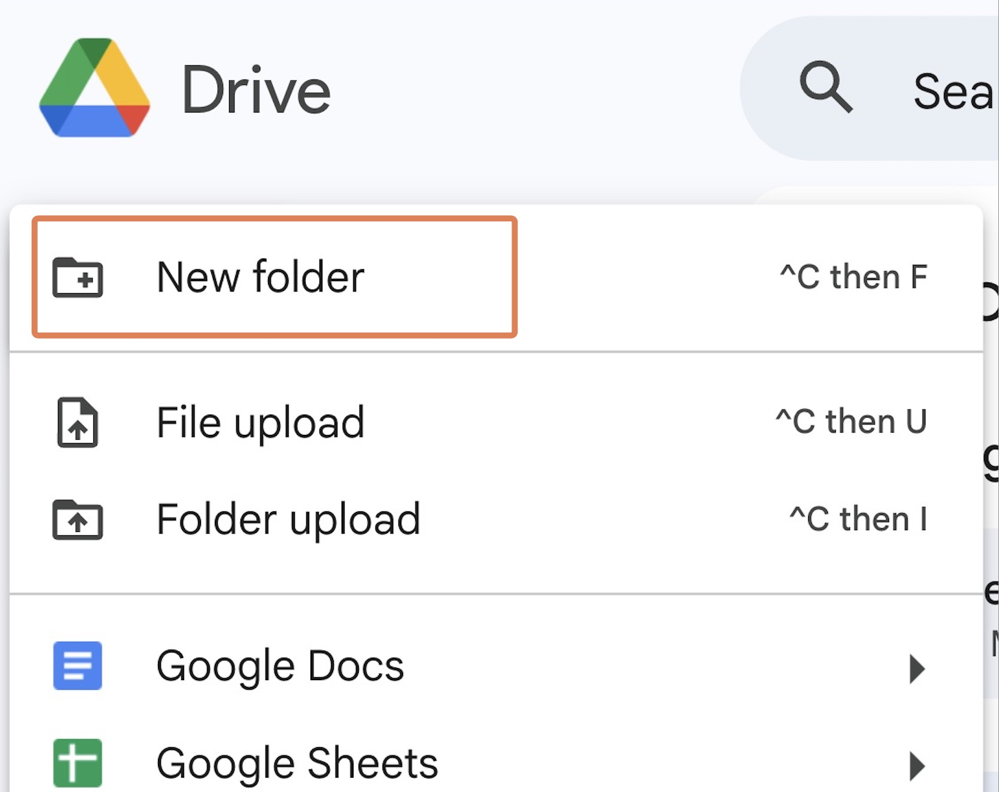{fig-alt="Create a new folder" width="300"}

4.  Name the folder something like `GenAI Consultations`
5.  Double-click to open the folder

{width="619"}

## Build Your Consultation Form

1.  Inside the folder, click **New** → **Google Forms** → **Blank Form**. You can close the Gemini quickstart helper if that pops up. 

2.  In the title field enter: `Consultation Inquiry`

3.  Set up the following form questions:

    -   **Question 1:** "Name" (Short answer)
    -   **Question 2:** "Email" (Short answer)
    -   **Question 3:** "What is your company name and primary geographic area?" (Short answer)
    -   **Question 4:** "What would you like help with?" (Paragraph)

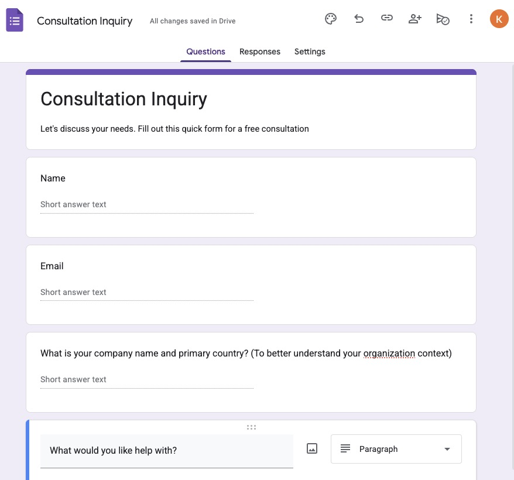{width="525"}

4.  When done, click **Publish** at the top right to make your form live.

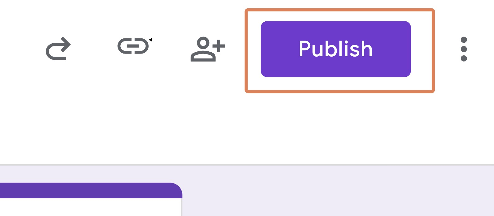{fig-alt="Publish the form" width="300"}

## Test Your Form and Connect to Sheets

1.  Click the Share button at the top right, then copy the responder link.

2.  Paste that link into a new tab and submit a test response. Try to use a real organization you know and care about. Example:

    -   Name: `John Doe`
    -   Email: `john.doe@example.com`
    -   Company: `The Graduate Institute, Geneva`
    -   Help needed: `General advice on how to use GenAI to help students`

3.  Return to the form editor tab and click **Responses**. You should see your new submission.

4.  Click **Link to Sheets** → **Create** to generate a connected spreadsheet.

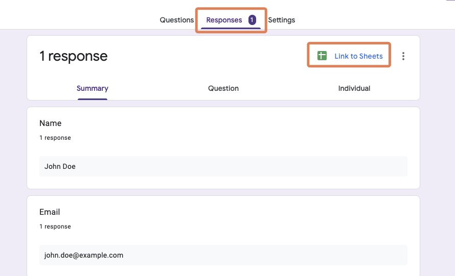{fig-alt="Link to Sheets" width="300"}

5.  Open the connected spreadsheet. You should see your test response as a row. Copy the spreadsheet URL from your browser's address bar. You'll paste this into ChatGPT shortly. Use the spreadsheet link, not the form's responder link.

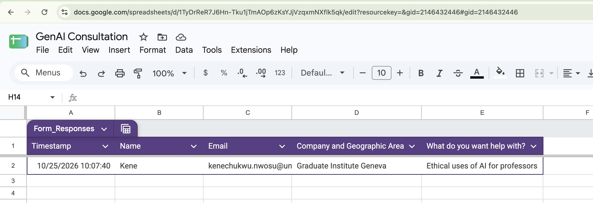{fig-alt="Connected Google Sheet with the test response in row 2 and the spreadsheet URL in the address bar" width="620"}

------------------------------------------------------------------------

# Part 3: Building the Automation with ChatGPT

## 3.1 Describe Your Scheduled Task

1.  Open a new chat in [ChatGPT](https://chatgpt.com){target="_blank"}. The toggle at the top of the page lets you choose between **Chat** and **Work**. Select **Work**.

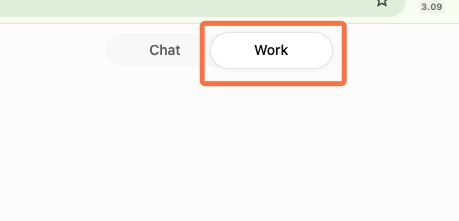{fig-alt="Chat and Work toggle with Work highlighted" width="360"}

2.  Check the model selector. The default model, shown as something like **GPT-6.1 Sol Medium**, is strong enough for this task. Leave it as it is.

{fig-alt="Model selector showing GPT-6.1 Sol Medium" width="320"}

3.  Paste the prompt below into the regular chat box. ChatGPT will build the scheduled task for you. Replace the two placeholders with your spreadsheet link and your AI assistant email address.

**Prompt to paste:**

```
Create a scheduled task called "Client GenAI Reports".

Once a day, check this Google Form response spreadsheet using my connected Google Drive:

[PASTE YOUR SPREADSHEET LINK HERE]

For each new submission, research the organization on the web and create a concise, colorful PDF report on GenAI opportunities. 

Include an organization overview, 3 useful opportunities related to their request, practical next steps, and source links.

Use my connected Gmail to email the report to me at [YOUR ASSISTANT GOOGLE EMAIL ADDRESS], with the PDF file attached. 

On the first run, process the existing test submission too. 

Leave the spreadsheet unchanged. 

If there are no new submissions, do nothing.
```

4.  Send the prompt. Answer any setup questions and review the proposed task.
5.  Confirm that it checks **once a day**, reads the correct spreadsheet, and sends to **your AI assistant email address**. Then save or confirm the task.

6.  Go to [chatgpt.com/scheduled](https://chatgpt.com/scheduled){target="_blank"}. You should see your new task listed under **Active**.

7.  Open the task to check the saved prompt and the daily schedule. You can edit it from here if anything needs changing.

::: callout-tip
If ChatGPT cannot open the spreadsheet, ask: `Use the Google Drive connection to read this spreadsheet: [YOUR LINK]`. Check the connected Google account if it still fails. Keep the sheet private.
:::

## 3.2 Test the Task Twice

1.  On [chatgpt.com/scheduled](https://chatgpt.com/scheduled){target="_blank"}, click the three dots (**...**) beside your task and choose **Run now**. The menu may look like either of these:

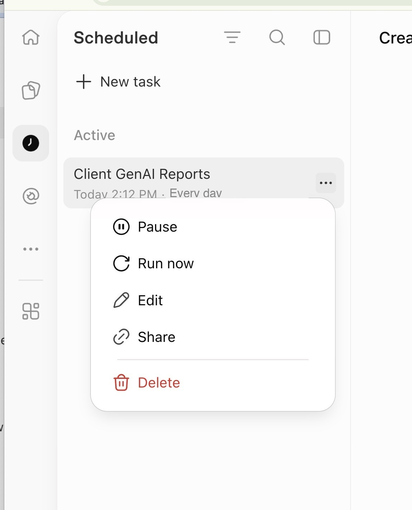{fig-alt="Task menu with Pause, Run now, Edit, Share and Delete" width="360"}

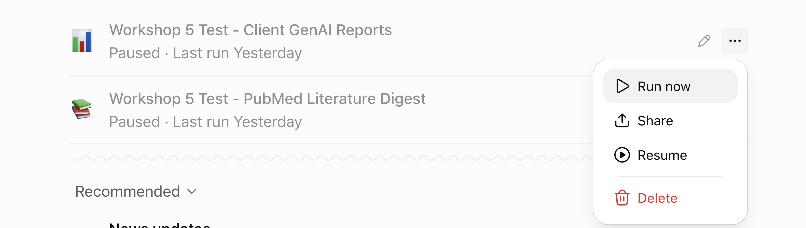{fig-alt="Task menu with Run now, Share, Resume and Delete" width="620"}

If **Run now** isn't shown, ask in the task's chat:

```
Run this task once now using my existing test submission, including emailing me the report.
```

2.  Review the run. If ChatGPT asks for access or permission to send, complete that step and run it again.
3.  Check your inbox and Sent mail. Download the PDF attachment and open it. Does it cover the right organization and the help requested?

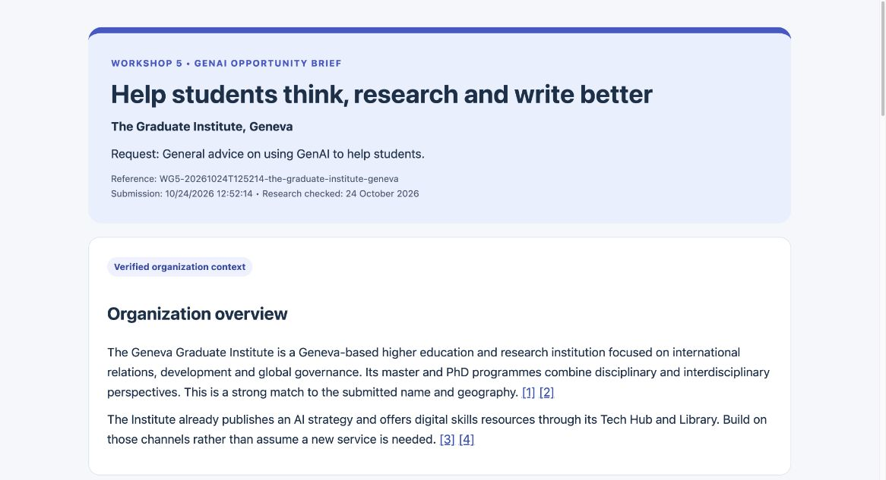{fig-alt="Actual test report generated and emailed by the ChatGPT task" width="620"}

4.  Run the task again without adding a new form response. You should **not** receive the same report twice.

::: callout-tip
If the report needs work, describe the change in the task's chat. For example: `Update the scheduled task so reports are shorter and include more concrete examples.` Check that the saved task prompt has updated too.
:::

## 3.3 Leave It Running

1.  Go to [chatgpt.com/scheduled](https://chatgpt.com/scheduled){target="_blank"} and check that your task is listed under **Active**.
2.  Open **Edit** to check the saved prompt and daily schedule. You can pause the task here when you no longer need it.

Your automation is now ready. New responses will be picked up at the next scheduled check, which may be up to a day later.

------------------------------------------------------------------------

# Part 4: Embedding the Form in Your Website

## Get the Embed Code

1.  Return to your Google Form
2.  Click the three-dot menu (⋮) in the top right
3.  Select **Embed HTML**
4.  Copy the provided HTML embed code


## Add to Your Portfolio Website

You'll use an LLM to add the form to your portfolio HTML, then push the changes to GitHub.

### Copy Your Current Website Code

1.  Go to [github.com](https://github.com){target="_blank"}. Click your profile icon at the top right → **Your repositories**.

    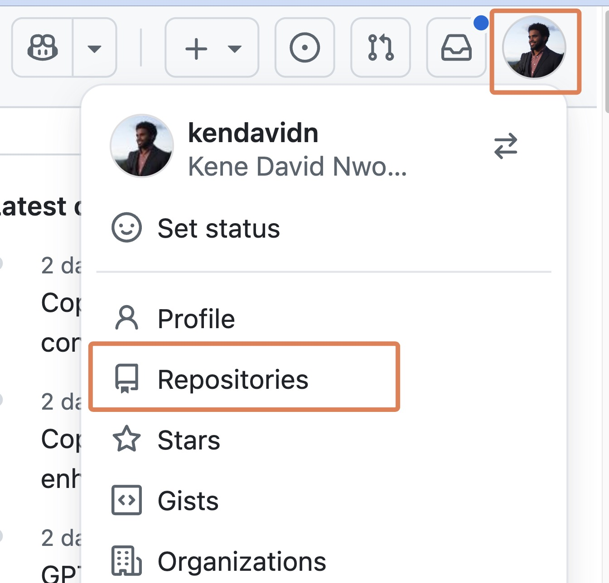{width="324"}

2.  Locate and click on your portfolio repository (it should be called something like `graph-ai-portfolio`).

3.  Click on the `index.html` file.

    {width="374"}

4.  Copy all the code from the file using the **copy** button at the top right of the code view.

    {width="372"}

### Ask an LLM to Update the HTML

1.  Go to ChatGPT, Gemini, or your preferred LLM.

2.  Paste a prompt like the one below, filling in your embed code and your current `index.html` code where indicated:

```         
I want to update my portfolio website to include a consultation form.

Add a new section called "Contact for Consultation" and embed this Google Form:

[PASTE YOUR GOOGLE FORM EMBED CODE HERE]

Below is my current index.html code. Please return the FULL updated HTML file:

[PASTE YOUR ENTIRE index.html CODE HERE]
```

3.  Review the LLM's output to make sure it looks reasonable (e.g., your existing content is still there and the embed code has been added).

### Update Your Website on GitHub

1.  Back in your repository on GitHub, navigate to `index.html` and click the **edit file** (pencil) button at the top right.

    {width="452"}

2.  Select all the existing code in the editor and delete it, then paste in the new HTML from the LLM.

3.  Click the **Commit changes** button at the top right to save.

4.  Your live site will update automatically. This may take 3 to 5 minutes. You can track the deployment status by clicking the **Actions** tab in your repository.

    {width="380"}

5.  Once the build completes, visit your GitHub Pages URL and confirm the consultation form section appears on your site. You may need to hard-refresh the page (Ctrl+Shift+R or Cmd+Shift+R) to bypass your browser's cache.

    {width="353"}

## Test the Full Pipeline

Now test the entire pipeline end to end.

1.  Visit your live GitHub Pages site and fill out the consultation form. Use a different company name than your earlier test so you can identify the new submission.

2.  Open your task in ChatGPT and run it once now, as you did earlier. Otherwise, wait for the next daily check.

3.  Check your email for the report and review the PDF attachment.

If a report arrives, your automation is working end to end, from website visitor to delivered report!

------------------------------------------------------------------------

# Submission

To submit your work, upload one of the PDF reports your automation emailed you.

------------------------------------------------------------------------

# Part 5: Optional Challenge: PubMed Literature Monitor *(ungraded)*

Here, you will build an automation that monitors academic literature and sends you a weekly digest. 

The steps are as follows:

1.  Create a PubMed search query for a topic of your choice
2.  Generate an RSS feed from that search
3.  Create a ChatGPT scheduled task that uses Python to read the feed every Monday, summarizes recent papers, and connects them to your research background

::: callout-tip
This challenge is less guided, with fewer screenshots. You'll need to be more independent.
:::

## Create Your PubMed RSS Feed

### 1. Craft a search query

PubMed searches use Boolean operators. You can write one yourself if you're familiar with the syntax, or use an LLM to help.

Pick a topic, for example :

-   Any paper about arboviruses in a top 5 medical journal
-   Generative AI and epidemiology
-   Clinical trials for a specific disease (e.g., malaria vaccine trials)

Ask an LLM to help you craft the query. For example:

```         
Help me create a PubMed search query using Boolean operators.

Return just the query string I can paste into PubMed.

I will use this to create a weekly RSS feed that will get emailed to me. 

[YOUR TOPIC HERE]
```

Replace `[YOUR TOPIC HERE]` with the topic you picked. The model will respond with a query string you can copy.

### 2. Search PubMed and create the RSS feed

1.  Go to [pubmed.ncbi.nlm.nih.gov](https://pubmed.ncbi.nlm.nih.gov){target="_blank"}, paste your query into the search box, and press **Search**.

::: callout-tip
Aim for 100 to 1,000 total results. Too broad gives generic papers; too narrow means you will probably get nothing new each week. Check the result count and refine with the LLM if needed.
:::

2.  Just below the search bar, click the **Create RSS** link.

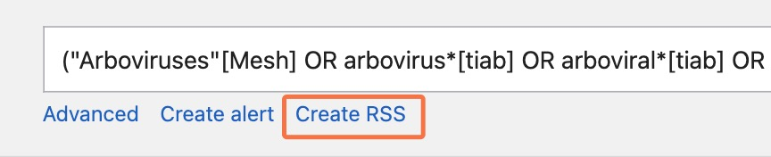{fig-alt="Create RSS button on PubMed" width="539"}

3.  Change *Number of items displayed* to **10**, then click **Create RSS**. A URL appears in the *Your RSS Feed Link* box. Copy it.

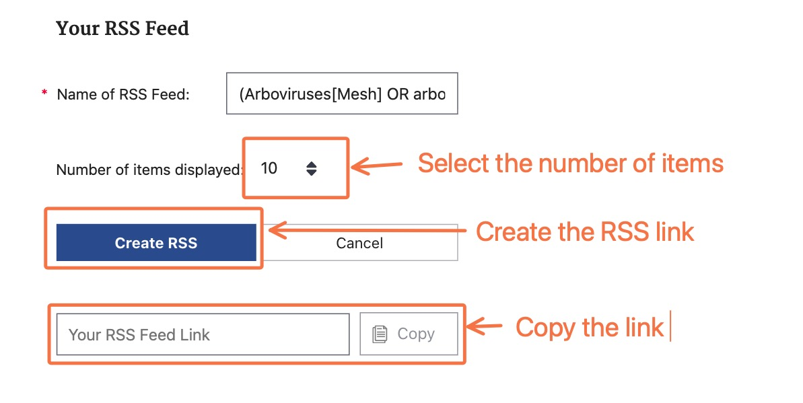{fig-alt="RSS feed settings" width="629"}

## Build the ChatGPT Scheduled Task

1.  Open a new chat in [ChatGPT](https://chatgpt.com){target="_blank"} with **Work** selected and **GPT-6.1 Sol Medium** as the model, as in section 3.1.
2.  Paste the prompt below, replacing the placeholders with your RSS URL, email address, time zone, and a short summary of your professional background.

```
Create a scheduled task called "PubMed Literature Digest".

Every Monday at 9 am in [YOUR TIME ZONE], use Python to download and parse this PubMed RSS feed:

[PASTE YOUR PUBMED RSS URL HERE]

Use Python to access the RSS feed directly, rather than opening it as a web page.

For up to 10 papers added to the feed in the last 7 days, give the title, a one-line summary, and the publication link. 

End the report with a few ways these papers relate to my background below. Do not repeat papers from previous digests.

Email the digest to me at my address below using my connected Gmail:

[YOUR ASSISTANT GOOGLE EMAIL ADDRESS]

I authorize sending this weekly email automatically. If there are no new papers, say so briefly in the email, without any attachments. 

My CV/professional summary is pasted below:

[PASTE YOUR PROFESSIONAL BACKGROUND HERE]

```

3.  You can open the saved task to review the Monday schedule and your email address.

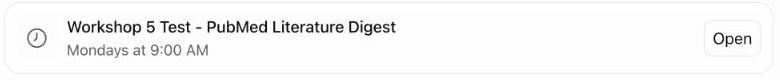{fig-alt="Created PubMed scheduled task card showing Mondays at 9 AM" width="620"}

4.  Run the task once now and check the email.

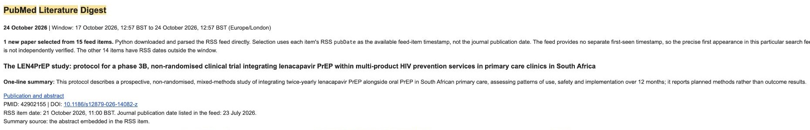{fig-alt="Example PubMed digest email with Python RSS retrieval, a supported paper summary, and publication links" width="720"}

------------------------------------------------------------------------

# Optional: Add Your Report to Your Portfolio

If you received a PDF report from the automation, you can add it to your GitHub Pages portfolio website under a section for this week's workshop.

### Upload Your Report to GitHub

1.  First, download the PDF report from the email attachment (if you haven't already).

2.  Go to [github.com](https://github.com){target="_blank"}. Click your profile icon at the top right → **Your repositories**.

    {width="324"}

3.  Locate and click on your portfolio repository (e.g., `graph-ai-portfolio`).

4.  Click **Add file** → **Upload files**. 

    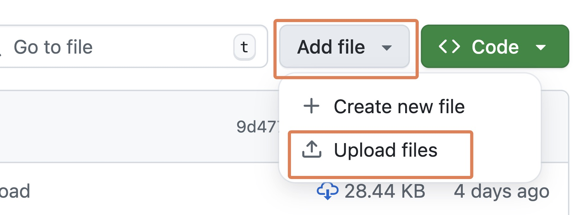{width="459"}

5.  Drag your PDF report file into the box, then click **Commit changes**.

### Update Your Portfolio with ChatGPT or Gemini

1.  Go to ChatGPT, Gemini, or your preferred LLM and start typing a prompt like the one below. The parts in square brackets will need to be filled in with information you'll gather in the next steps.

```         
I want to update my portfolio website. In your response, you will provide the FULL updated HTML code for the index.html file.

The portfolio website is hosted at 

[YOUR PORTFOLIO WEBSITE URL HERE].

---

I want to add a new link and description for the project page for "Workshop 5: Automation with ChatGPT Scheduled Tasks".

For this project, I built a ChatGPT scheduled task that checks consultation form responses once a day, researches new clients, and emails me a GenAI opportunities report.

The report is available at the link below. It is a PDF file, so reformat the link to be a clickable GitHub Pages link, since it is hosted on the same GitHub repo as the portfolio website.

[PASTE THE DIRECT LINK TO YOUR UPLOADED REPORT FILE HERE]

---

Below is my current HTML file:

[PASTE THE ENTIRE HTML FILE HERE]
```

2.  Now, gather the information you need to complete the prompt:

### Get Your Portfolio Website URL

-   To get your portfolio website URL, go to your portfolio repository on GitHub. You can do this by clicking on the "Repositories" button at the top right of the page and then clicking on your portfolio repository.

-   Click on the "Settings" tab.

-   Scroll down to the "GitHub Pages" section.

-   Your portfolio website URL will be listed under "GitHub Pages". Copy and paste this into your prompt.

    {width="378"}

### Get the Direct Link to Your Report

-   Go back to your portfolio repository's main page and right‑click on the name of your uploaded report then → **Copy link address**. Paste this into your prompt.

    {width="378"}

### Copy Your Current index.html Code

-   Still in your portfolio repository, navigate to your index.html file.

    {width="374"}

-   Copy all the code from the index.html file with the copy code button at the top right. Paste this into your prompt.

    {width="372"}

### Send the Prompt and Update Your File

-   Now that you've filled in all the placeholders, send the prompt to ChatGPT or Gemini

-   Copy the new HTML that the LLM generated → return to your *index.html* on GitHub → click the **edit file** (✎) button at the top right.

    {width="452"}

-   Delete all the existing code in the file, then paste in the new code from ChatGPT or Gemini.

-   At the top right, click the **Commit changes** button.

-   Go to Actions tab (if you have GitHub Pages set up with Actions).

    {width="380"}

-   Click on the latest build to observe the build process.

    {width="353"}

-   After the build is complete, your live site, if refreshed, should now show the new project entry and the link should work!
