# Overview

In this session you will turn a research paper into a **visual abstract** using two different GenAI design workflows, then compare them:

1.  **SVG-based**: ChatGPT writes the visual abstract as SVG code, which you then edit in **PowerPoint**.
2.  **Image-based**: ChatGPT generates the visual abstract as an image, which you then edit in **Canva**.

A visual abstract is a pictorial summary of the main findings of a research paper. It's a great way to communicate key results in an appealing visual format.

At the end, you'll put both versions side by side in a single document with a short comparison table. That document is what you submit.

**Accounts Required**: You'll need a free **ChatGPT** account ([chatgpt.com](https://chatgpt.com/){target="_blank"}) and a free **Canva** account ([canva.com](https://www.canva.com/){target="_blank"}).

Side Note: We use ChatGPT for both workflows, but **Gemini** ([gemini.google.com](https://gemini.google.com/){target="_blank"}) will also work if you prefer it. **Claude** does not yet have a native image generation model, but instead of an image you can ask it for a **"Claude design"**, which gives you a design you can edit directly in the Claude interface.

# Step 1: Preparation

### 1-A Choose Your Paper

Pick a research paper you are interested in (ideally one from your own field, or even your own work) and **download the PDF**. You'll attach the PDF to ChatGPT in the next steps.

### 1-B Find Some Design Inspiration

1.  Do a Google search (or Google Images search) for **"visual abstract"**.

2.  Browse the results and find a visual abstract whose visual style you like and think could work for your paper.

3.  Take a screenshot of it and save it. You'll attach it alongside your paper in both prompts below.

# Step 2: SVG-Based Visual Abstract

### 2-A Generate the SVG with ChatGPT

1.  Go to [chatgpt.com](https://chatgpt.com/){target="_blank"} and log in.

2.  Attach your paper PDF and your inspiration screenshot using the **+** button in the prompt box.

3.  Paste the following prompt (or write a similar one) and press Enter:

```
Create a rich, accurate, and visually appealing SVG code-based visual abstract in 16:9 format, light mode, of the attached paper. 
Take some design inspiration from the screenshot attached. 
Return the SVG as a downloadable .svg file.
```

4.  If you don't like the initial generation, ask ChatGPT for specific changes. For example, "make the subtitle larger, italic, and use a different color/font," or "simplify the icons in the results section."

::: {.callout-tip}
## Don't over-chat your design

Describing small visual tweaks in text ("move that box a bit to the left… no, a little less") quickly gets tedious, and each regeneration can break things that were already fine. 

For this reason, we recommend using the chat for big-picture changes (layout, style, content), but then switching to a proper graphical editor for final touches, where you can click, drag and fix details directly.

For SVG-based visual abstracts, we can convert from SVG to Powerpoint shapes. We will do this in the next step. For image-based visual abstracts, we will use an AI tool within Canva to convert the pixels into shapes.

:::

### 2-B Edit in PowerPoint

1.  Download the SVG file from ChatGPT by clicking the **download** button next to the file name.

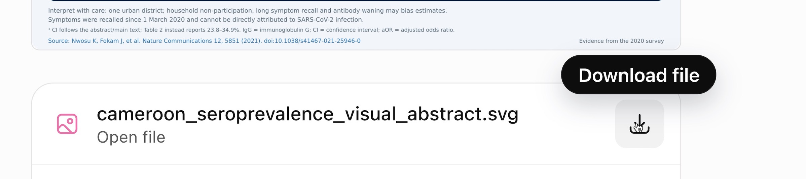{width="600"}

2.  Open PowerPoint and drag the downloaded SVG file into a slide.

3.  To make the elements editable, right-click on the image and click **"Convert to Shape"**. Then right-click again and click **Group → Ungroup**. You may need to repeat the ungroup step several times until there's nothing left to ungroup.

::: {.panel-tabset}
## Mac

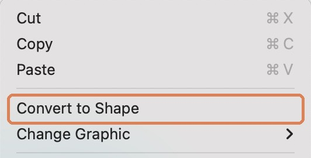{width="400"}

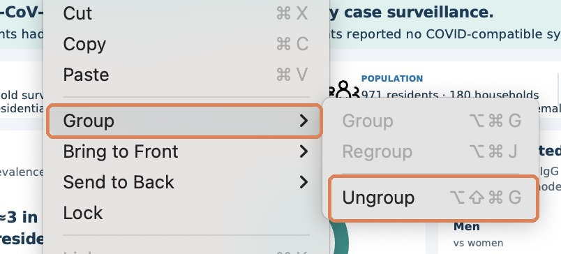{width="500"}

## Windows

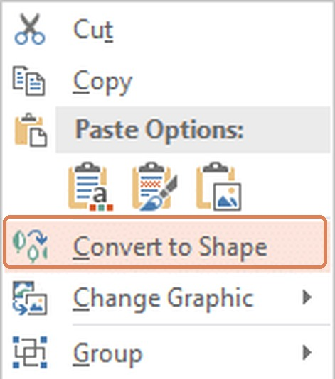{width="220"}

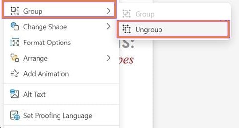{width="400"}
:::

4.  After converting the SVG, the font sizes are often too big. To shrink everything at once, select all objects in the slide and click the **"A" with the downward caret** (the "decrease font size" button) until the text fits.

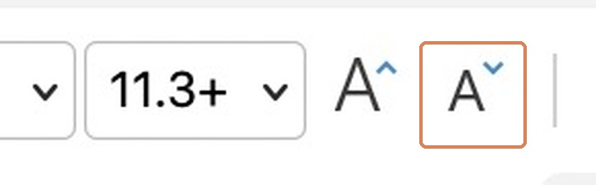{width="300"}

5.  Some of the elements may have become malformed during the conversion process. Fix these, and make any other edits you'd like to individual elements.

6.  Save your work for now. We will come back to it later.

# Step 3: Image-Based Visual Abstract

### 3-A Generate the Image with ChatGPT

1.  Start a new chat in ChatGPT.

2.  Attach your paper PDF and your inspiration screenshot again.

3.  Click the **+** button in the prompt box and select **"Create image"**.

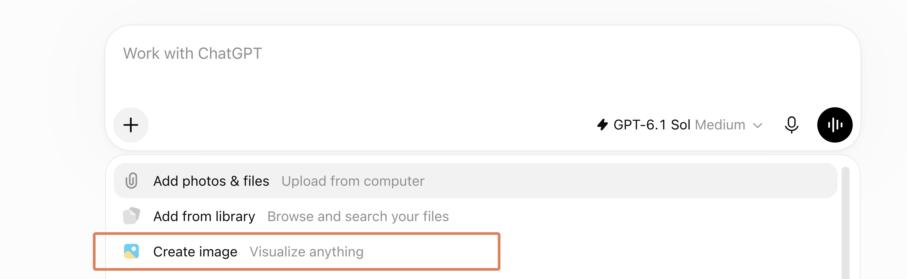{width="600"}

4.  Paste the following prompt (or write a similar one) and press Enter:

```
Create a rich, accurate, and visually appealing visual abstract image in 16:9 format, light mode, of the attached paper. 
Take some design inspiration from the screenshot attached.
```

5.  If you don't like the initial generation, ask ChatGPT for specific changes. For example, "use a warmer color palette" or "make the central illustration larger." 

6.  Once you're relatively happy with the image, click on it to open it, then click the **download** button at the top.

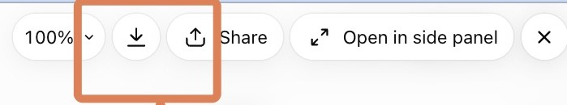{width="500"}

### 3-B Bring the Image into Canva

1.  Go to [canva.com](https://www.canva.com/){target="_blank"} and sign up for a free account or log in.

2.  In Canva, go to the **Home** tab in the left sidebar.

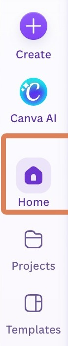{width="120"}

3.  Drag your downloaded image into the empty space to upload it.

4.  Open the uploaded image, then click **"Open in editor"** at the top right.

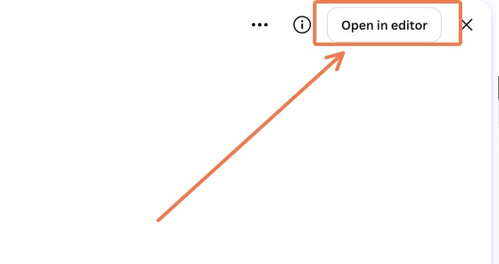{width="400"}

5.  In the editor, hover over the image and click the **"Edit"** button at the top left.

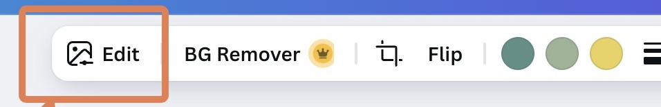{width="500"}

This reveals the editing tools, including **Magic Layers**.

### 3-C Edit with Magic Layers

1.  Click on the **Magic Layers** tool.

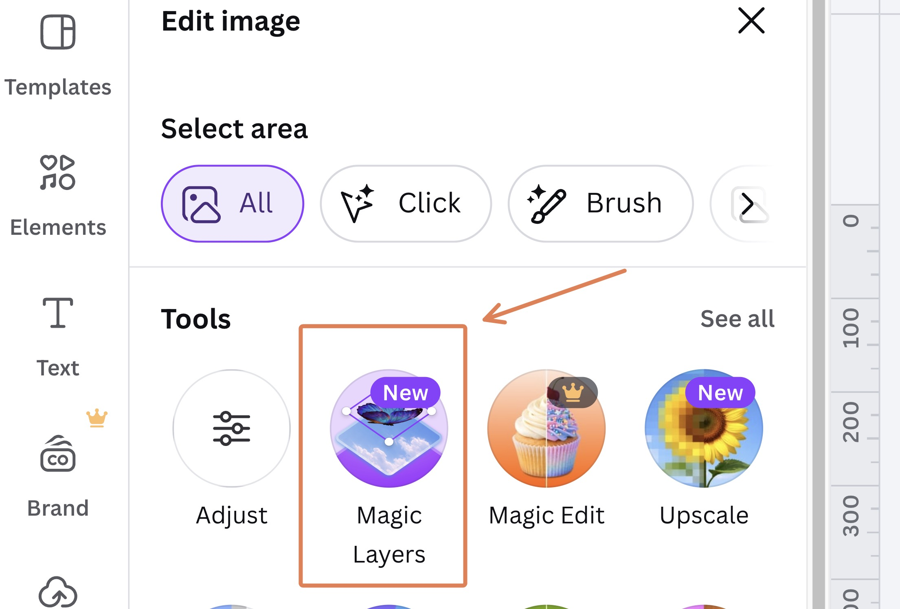{width="500"}

2.  Canva will separate the image into editable layers, including the text.

3.  Make **at least one or two edits** to practice the workflow. For example: fix a spelling or factual error in a label, change the font or color of a heading, or move or remove an element.

4.  When finished, click **Share → Download**, keep the file type as PNG, and click **Download** again.

Side Note: Now that Magic Layers has split the image into separate layers, you can also download the design as a **PowerPoint (PPTX)** file (choose it as the file type in **Share → Download**). The layer separations are preserved, so you can keep editing each element in PowerPoint.

# Step 4: Compare and Submit

1.  Create a single **PowerPoint** or **Word** document and add both versions of your visual abstract (for the PowerPoint version, you can export the slide as an image or simply copy it in).

2.  Below them, add a table comparing the two approaches:

|                              | Image-based | SVG-based |
|------------------------------|-------------|-----------|
| Quality of the illustration  |             |           |
| Errors and defects           |             |           |
| Ease of editing              |             |           |
| Other comments               |             |           |

3.  Include a link to the original paper.

4.  Save as a PDF and upload the document to the assignment submission area on the course website.

# Optional Challenge: Turn Your Visual Abstract into a Video

Now let's go one step further and have ChatGPT turn your paper into a short narrated video.

1.  Start a new chat in ChatGPT and upload the final version of your favorite visual abstract (SVG-based or image-based), along with the paper PDF for context.

2.  Pick a narration voice. You can listen to samples of the OpenAI text-to-speech voices at [texttolab.com/openai](https://texttolab.com/openai){target="_blank"}.

    Side Note: For the most lifelike voices, plus voice cloning (e.g., narrating in your own voice), [ElevenLabs](https://elevenlabs.io/){target="_blank"} is better. We use OpenAI here because it's simpler to set up for the class.

3.  Paste the following prompt, replacing the placeholders with your chosen voice and the OpenAI API key we share in class:

```
Make a 1-minute, 16:9 video introducing and animating the findings of the attached paper, for a general audience. Use the attached visual abstract as the main visual.

For the narration, use OpenAI text-to-speech with the "[VOICE NAME]" voice. Here is an API key: [API KEY FROM CLASS]
```

4.  Watch the result and ask for changes if needed (e.g., "slow down the narration" or "zoom in on the results panel when they are mentioned"), then download the video.

**How does ChatGPT make the video?** It doesn't have a video generation model here. Instead, it writes and runs code behind the scenes: it crops and zooms into parts of your visual abstract (and may draw simple titles or animations), generates the narration audio with the TTS API, and then stitches the frames and audio together into an MP4, typically with a tool called **ffmpeg**.

Side Note: Please keep the API key private and don't share it outside the class.

There's a whole world of videos you can make this way: explainers, animated charts, slideshows, even music videos. For inspiration, browse this list: [awesome-claude-video-skills](https://github.com/zhuyansen/awesome-claude-video-skills#type-music){target="_blank"}.
