# Overview

In this exercise you will turn a research paper into a **visual abstract** using one GenAI design workflow.

Do only one of these:

1.  **If you have a paid ChatGPT account:** generate the visual abstract as an image, then edit it in **Canva**.
2.  **Otherwise:** have ChatGPT write the visual abstract as SVG code, then edit it in **PowerPoint**.

A visual abstract is a pictorial summary of the main findings of a research paper. It's a great way to communicate key results in an appealing visual format.

**Accounts:**

-   **Paid ChatGPT path:** a paid **ChatGPT** account ([chatgpt.com](https://chatgpt.com/){target="_blank"}) and a free **Canva** account ([canva.com](https://www.canva.com/){target="_blank"}).
-   **SVG path:** a free **ChatGPT** account and PowerPoint. **Gemini** ([gemini.google.com](https://gemini.google.com/){target="_blank"}) can also write the SVG if you prefer it. The steps below are written for ChatGPT.

# Step 1: Preparation

### 1-A Choose Your Paper

Pick a research paper you are interested in (ideally one from your own field, or even your own work) and **download the PDF**. You'll attach the PDF in the next step.

### 1-B Find Some Design Inspiration

1.  Do a Google search (or Google Images search) for **"visual abstract"**.

2.  Browse the results and find a visual abstract whose visual style you like and think could work for your paper.

3.  Take a screenshot of it and save it. You'll attach it alongside your paper.

# Step 2: Make One Visual Abstract

Follow the section that matches your account. Skip the other one.

## If you have paid ChatGPT: image, then Canva

### Generate the image with ChatGPT

1.  Go to [chatgpt.com](https://chatgpt.com/){target="_blank"} and log in.

2.  Attach your paper PDF and your inspiration screenshot using the **+** button in the prompt box.

3.  Click the **+** button in the prompt box and select **"Create image"**.

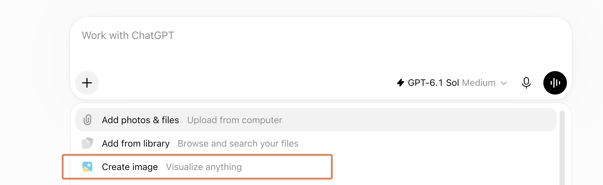{width="600"}

4.  Paste the following prompt (or write a similar one) and press Enter:

```
Create a rich, accurate, and visually appealing visual abstract image in 16:9 format, light mode, of the attached paper. 
Take some design inspiration from the screenshot attached.
```

5.  If you don't like the initial generation, ask ChatGPT for specific changes. For example, "use a warmer color palette" or "make the central illustration larger."

::: {.callout-tip}
## Don't over-chat your design

Describing small visual tweaks in text ("move that box a bit to the left… no, a little less") quickly gets tedious, and each regeneration can break things that were already fine.

Use the chat for big-picture changes (layout, style, content), then switch to Canva for final touches, where you can click and fix details directly.
:::

6.  Once you're relatively happy with the image, click on it to open it, then click the **download** button at the top.

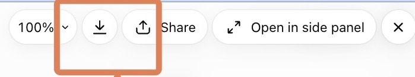{width="500"}

### Bring the image into Canva

1.  Go to [canva.com](https://www.canva.com/){target="_blank"} and sign up for a free account or log in.

2.  In Canva, go to the **Home** tab in the left sidebar.

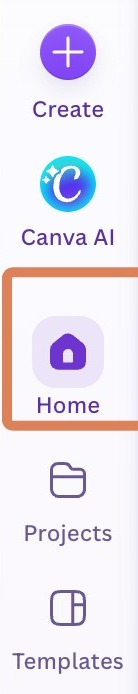{width="120"}

3.  Drag your downloaded image into the empty space to upload it.

4.  Open the uploaded image, then click **"Open in editor"** at the top right.

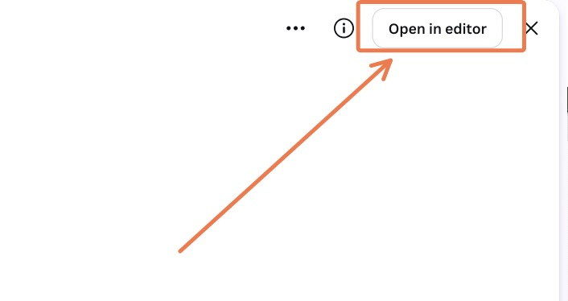{width="400"}

5.  In the editor, hover over the image and click the **"Edit"** button at the top left.

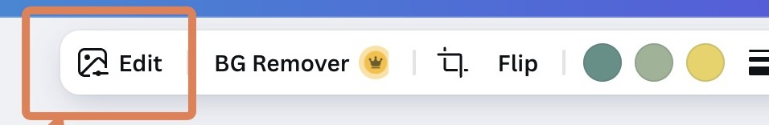{width="500"}

This reveals the editing tools, including **Magic Layers**.

### Edit with Magic Layers

1.  Click on the **Magic Layers** tool.

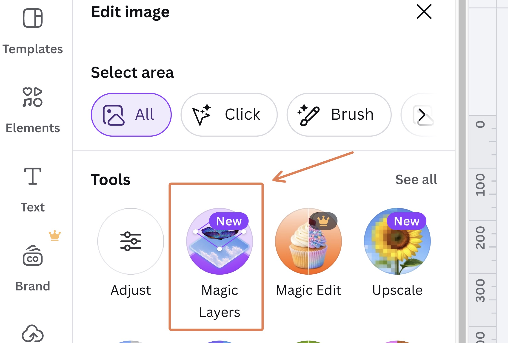{width="500"}

2.  Canva will separate the image into editable layers, including the text.

3.  Make **at least one or two edits**. For example: fix a spelling or factual error in a label, change the font or color of a heading, or move or remove an element.

4.  When finished, click **Share → Download**, keep the file type as PNG, and click **Download** again. This file is what you will submit.

Side note: Now that Magic Layers has split the image into separate layers, you can also download the design as a **PowerPoint (PPTX)** file (choose it as the file type in **Share → Download**). The layer separations are preserved, so you can keep editing each element in PowerPoint. You may submit the PPTX instead of the PNG.

## Otherwise: SVG, then PowerPoint

### Generate the SVG with ChatGPT

1.  Go to [chatgpt.com](https://chatgpt.com/){target="_blank"} and log in.

2.  Attach your paper PDF and your inspiration screenshot using the **+** button in the prompt box.

3.  Paste the following prompt (or write a similar one) and press Enter:

```
Create a rich, accurate, and visually appealing SVG code-based visual abstract in 16:9 format, light mode, of the attached paper. 
Take some design inspiration from the screenshot attached. 
Return the SVG as a downloadable .svg file.
```

4.  If you don't like the initial generation, ask ChatGPT for specific changes. For example, "make the subtitle larger, italic, and use a different color/font," or "simplify the icons in the results section."

::: {.callout-tip}
## Don't over-chat your design

Describing small visual tweaks in text ("move that box a bit to the left… no, a little less") quickly gets tedious, and each regeneration can break things that were already fine.

Use the chat for big-picture changes (layout, style, content), then switch to PowerPoint for final touches, where you can click, drag, and fix details directly.
:::

### Edit in PowerPoint

1.  Download the SVG file from ChatGPT by clicking the **download** button next to the file name.

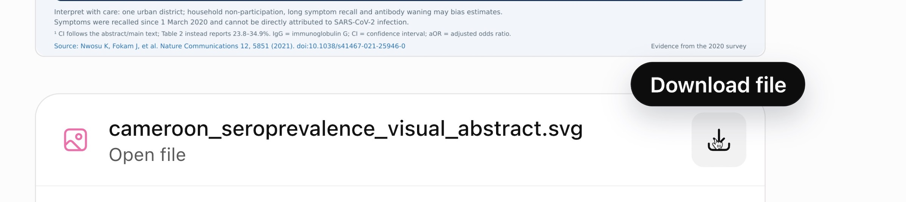{width="600"}

2.  Open PowerPoint and drag the downloaded SVG file into a slide.

3.  To make the elements editable, right-click on the image and click **"Convert to Shape"**. Then right-click again and click **Group → Ungroup**. You may need to repeat the ungroup step several times until there's nothing left to ungroup.

::: {.panel-tabset}
## Mac

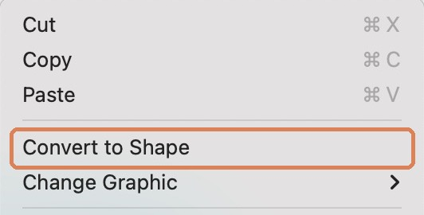{width="400"}

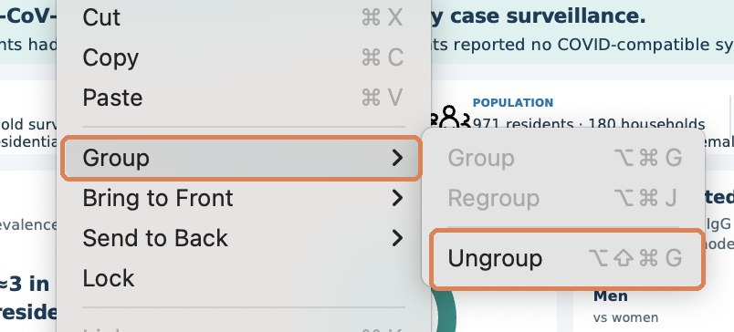{width="500"}

## Windows

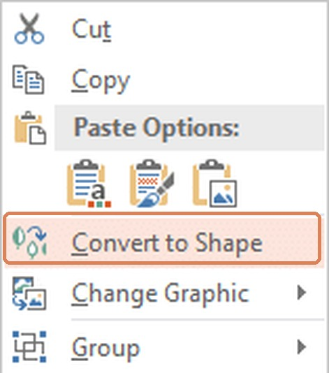{width="220"}

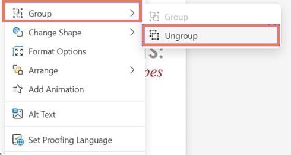{width="400"}
:::

4.  After converting the SVG, the font sizes are often too big. To shrink everything at once, select all objects in the slide and click the **"A" with the downward caret** (the "decrease font size" button) until the text fits.

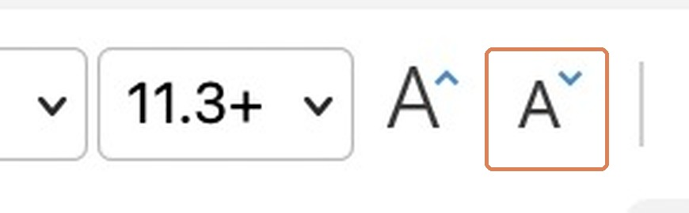{width="300"}

5.  Some of the elements may have become malformed during the conversion process. Fix these, and make any other edits you'd like to individual elements.

6.  Save the PowerPoint file. This file is what you will submit.

# Step 3: Submission

Email your visual abstract file to [courses@thegraphnetwork.org](mailto:courses@thegraphnetwork.org).

-   **Image path:** attach the PNG (or the PPTX, if you downloaded that).
-   **SVG path:** attach the PowerPoint file.

Use this subject line, replacing the name with your own:

`Quantitative Methods Submission 2: FIRST NAME LAST NAME`

In the body of the email, comment on:

-   the quality of the illustration
-   errors and defects
-   how easy it was to edit

# Optional Challenge: Turn Your Visual Abstract into a Video

Now let's go one step further and have ChatGPT turn your paper into a short narrated video.

1.  Start a new chat in ChatGPT and upload your visual abstract, along with the paper PDF for context.

2.  Pick a narration voice. You can listen to samples of the OpenAI text-to-speech voices at [texttolab.com/openai](https://texttolab.com/openai){target="_blank"}.

    Side note: For the most lifelike voices, plus voice cloning (e.g., narrating in your own voice), [ElevenLabs](https://elevenlabs.io/){target="_blank"} is better. We use OpenAI here because it's simpler to set up for the class.

3.  Paste the following prompt, replacing the placeholders with your chosen voice and the OpenAI API key we share in class:

```
Make a 1-minute, 16:9 video introducing and animating the findings of the attached paper, for a general audience. Use the attached visual abstract as the main visual.

For the narration, use OpenAI text-to-speech with the "[VOICE NAME]" voice. Here is an API key: [API KEY FROM CLASS]
```

4.  Watch the result and ask for changes if needed (e.g., "slow down the narration" or "zoom in on the results panel when they are mentioned"), then download the video.

**How does ChatGPT make the video?** It doesn't have a video generation model here. Instead, it writes and runs code behind the scenes: it crops and zooms into parts of your visual abstract (and may draw simple titles or animations), generates the narration audio with the TTS API, and then stitches the frames and audio together into an MP4, typically with a tool called **ffmpeg**.

Side note: Please keep the API key private and don't share it outside the class.

There's a whole world of videos you can make this way: explainers, animated charts, slideshows, even music videos. For inspiration, browse this list: [awesome-claude-video-skills](https://github.com/zhuyansen/awesome-claude-video-skills#type-music){target="_blank"}.
